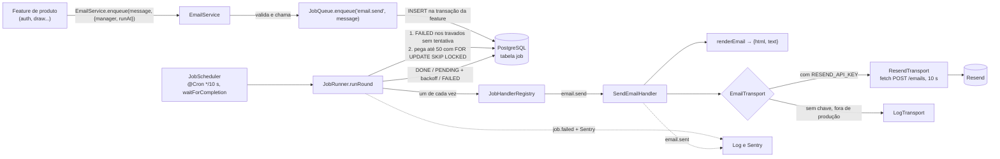

# Email Jobs Design

**Spec**: `.specs/features/02-email-jobs/spec.md`
**Context**: `.specs/features/02-email-jobs/context.md`
**Status**: Approved
**Approved**: 2026-11-18 - user: "Aprovado."

---

## Architecture Overview

Dois módulos novos na API. O `JobsModule` é a fila: grava jobs (`JobQueue`), guarda quem executa cada tipo (`JobHandlerRegistry`) e roda as rodadas (`JobRunner`). O `JobsSchedulerModule` liga o `@Cron` de 10 s ao `JobRunner` e só entra no `AppModule`. O `EmailModule` é o único que conhece o Resend: valida e enfileira (`EmailService`), registra o handler `email.send`, monta o layout (`renderEmail`) e entrega pelo transporte escolhido no boot (`ResendTransport` com chave, `LogTransport` sem chave fora de produção).



Uma rodada:

```mermaid
sequenceDiagram
    participant S as JobScheduler
    participant R as JobRunner
    participant D as PostgreSQL
    participant H as Handler
    S->>R: runRound(now)
    R->>D: UPDATE ... SET FAILED WHERE RUNNING, lockedAt < now-10min, attempts >= 5 RETURNING
    R-->>R: job.failed + Sentry para cada um
    R->>D: BEGIN; SELECT ... FOR UPDATE SKIP LOCKED LIMIT 50
    R->>D: UPDATE ... SET RUNNING, lockedAt = now, attempts + 1; COMMIT
    loop cada job, na ordem de runAt
        R->>H: handle(job)
        alt sucesso
            R->>D: UPDATE SET DONE WHERE id AND lockedAt = now
        else PermanentJobError ou tipo sem handler ou attempts = 5
            R->>D: UPDATE SET FAILED, lastError
            R-->>R: job.failed + Sentry
        else falha passageira
            R->>D: UPDATE SET PENDING, lastError, runAt = falha + 5^(attempts-1) min
            R-->>R: aviso no log
        end
    end
```

---

## Code Reuse Analysis

### Existing Components to Leverage

| Component | Location | How to Use |
| --- | --- | --- |
| Validação do ambiente | `apps/api/src/config/env.validation.ts` | Ganha `RESEND_API_KEY`, `EMAIL_FROM` e `RESEND_BASE_URL`; obrigatórias em produção com `@ValidateIf`. A mensagem de erro já nomeia a variável (JOB-05 AC 7). |
| Opções do banco | `apps/api/src/database/database.options.ts` | Ganha `entities` por glob (`**/*.entity.js`), usado pela API e pela CLI do TypeORM, para o `migration:generate` enxergar a entidade `Job`. |
| Scripts de migration | `apps/api/package.json` (`migration:generate`, `migration:run`, `migration:revert`) | Geram e aplicam a migration da tabela `job` (AD-004). |
| Eventos de negócio | `apps/api/src/observability/business-events.service.ts` | `email.sent` e `job.failed` (AD-005). `jobId`, `type` e `attempts` não colidem com os nomes reservados (lição L-007). |
| Logger | `apps/api/src/observability/app-logger.ts` | JSON em produção; o `Logger` do Nest com contexto `Jobs` e `Email`. |
| Sentry | `@sentry/nestjs`, já iniciado por `instrument.ts` | `Sentry.captureException` quando um job vira `FAILED`; desligado sem DSN. |
| Testes de integração | `apps/api/test/global-setup.ts`, `test/migrations.ts`, `test/fixtures/logging-fixture.module.ts`, `test/all-exceptions.int-spec.ts` | PostgreSQL do Testcontainers, captura de log e o padrão de checar chamadas ao Sentry. |
| Checagem de comando sem `dist/` | `apps/api/test/migrations.int-spec.ts` ("roda num clone sem build") | Mesmo teste para o `email:test` (JOB-08 AC 3, lição L-002). |
| Tokens do design system | `apps/web/src/app/globals.css` (`:root` e `.dark`) | Cores copiadas para o layout de e-mail (e-mail não lê CSS do web). |

### Integration Points

| System | Integration Method |
| --- | --- |
| Features de produto | Importam `EmailModule` e chamam `EmailService.enqueue`; jobs que não são e-mail importam `JobsModule` e usam `JobQueue.enqueue` + `JobHandlerRegistry.register`. |
| PostgreSQL | Tabela `job` por migration; `TypeOrmModule.forFeature([Job])` no `JobsModule`. |
| Resend | `POST {RESEND_BASE_URL}/emails` por `fetch`, com `Authorization: Bearer`, `Idempotency-Key` e `AbortSignal.timeout(10_000)`. |
| `AppModule` | Importa `JobsSchedulerModule` e `EmailModule`. |
| e2e do web | `apps/web/playwright.config.ts` sobe a API com `NODE_ENV=production`; passa a enviar `RESEND_API_KEY` e `EMAIL_FROM` fictícios para a API iniciar. |

---

## Components

### Entidade `Job` e migration

- **Purpose**: Guardar os jobs com status, tentativas e trava.
- **Location**: `apps/api/src/jobs/job.entity.ts`; `apps/api/src/database/migrations/<timestamp>-CreateJobTable.ts` (gerada por `migration:generate`).
- **Interfaces**: `Job` (ver Data Models); `JobStatus = 'PENDING' | 'RUNNING' | 'DONE' | 'FAILED'`.
- **Dependencies**: TypeORM.
- **Reuses**: scripts de migration da foundation.

### `JobQueue`

- **Purpose**: Gravar um job, dentro da transação de quem chama quando ela é passada.
- **Location**: `apps/api/src/jobs/job-queue.service.ts`
- **Interfaces**:
  - `enqueue<P extends object>(type: string, payload: P, options?: { runAt?: Date; manager?: EntityManager }): Promise<Job>` - usa `options.manager ?? this.dataSource.manager`; `status` `PENDING`, `attempts` 0, `runAt` = `options.runAt ?? new Date()`.
- **Dependencies**: `DataSource`.
- **Reuses**: nada.

### `JobHandlerRegistry`

- **Purpose**: Ligar cada `type` ao handler que o executa.
- **Location**: `apps/api/src/jobs/job-handler.registry.ts`
- **Interfaces**:
  - `interface JobHandler { handle(job: Job): Promise<void> }`
  - `register(type: string, handler: JobHandler): void` - lança `Error("Handler já registrado para o tipo <type>")` se o tipo repetir.
  - `get(type: string): JobHandler | undefined`
- **Dependencies**: nenhuma.

### Erros de job e backoff

- **Purpose**: Separar falha definitiva de passageira e calcular a próxima tentativa.
- **Location**: `apps/api/src/jobs/job-errors.ts`, `apps/api/src/jobs/job-retry.ts`
- **Interfaces**:
  - `class PermanentJobError extends Error` - o handler lança para falha definitiva; qualquer outro erro é passageiro.
  - `MAX_ATTEMPTS = 5`, `STUCK_AFTER_MS = 10 * 60_000`, `BATCH_SIZE = 50`
  - `nextRunAt(attempts: number, failedAt: Date): Date` - `failedAt + 5^(attempts-1)` minutos.
  - `toLastError(error: unknown): string` - `<error.name>: <error.message>` (ou `String(error)` quando não é `Error`), cortado em 500 caracteres. `PermanentJobError` tem `name` próprio.

### `JobRunner`

- **Purpose**: Executar uma rodada: falhar os travados sem tentativa, pegar até 50 jobs e executá-los um a um.
- **Location**: `apps/api/src/jobs/job-runner.service.ts`
- **Interfaces**:
  - `runRound(now: Date = new Date()): Promise<void>` - o relógio vem de fora para os testes controlarem `runAt` e `lockedAt`.
- **Dependencies**: `DataSource`, `JobHandlerRegistry`, `BusinessEventsService`, `Logger`, `@sentry/nestjs`.
- **Comportamento**:
  - Pega: numa transação, `SELECT` com `setLock('pessimistic_write')` + `setOnLocked('skip_locked')` onde (`status = PENDING` e `runAt <= now`) ou (`status = RUNNING` e `lockedAt < now - 10 min` e `attempts < 5`), `ORDER BY runAt`, `LIMIT 50`; depois `UPDATE` para `RUNNING`, `lockedAt = now`, `attempts + 1`.
  - Grava o resultado com `WHERE id = :id AND status = 'RUNNING' AND lockedAt = :now`, para não sobrescrever um job que outra instância retomou.
  - `FAILED`: `businessEvents.record('job.failed', { jobId, type, attempts })` e `Sentry.captureException(new Error('Job <type> falhou'), { tags: { jobId, type } })`. Nada do `payload` vai junto.
  - Volta a `PENDING`: `logger.warn('Job vai ser tentado de novo', { jobId, type, attempts, runAt })`.
  - Erro da própria rodada (ex.: banco fora): `logger.error` e a rodada termina; sem Sentry, para não mandar um erro a cada 10 s enquanto o banco está fora (lição L-010).

### `JobScheduler` e `JobsSchedulerModule`

- **Purpose**: Disparar a rodada a cada 10 s, sem sobrepor rodadas da mesma instância.
- **Location**: `apps/api/src/jobs/job.scheduler.ts`, `apps/api/src/jobs/jobs-scheduler.module.ts`
- **Interfaces**: `@Cron('*/10 * * * * *', { name: 'jobs', waitForCompletion: true }) tick(): Promise<void>` chama `runner.runRound()`. O `waitForCompletion` pula os ticks enquanto a rodada roda (JOB-03 AC 7).
- **Dependencies**: `@nestjs/schedule` 12.0.4; `ScheduleModule.forRoot({ cronJobs: process.env.NODE_ENV !== 'test' })`.
- **Reuses**: `JobsModule`.

### `JobsModule`

- **Purpose**: Expor a fila às features.
- **Location**: `apps/api/src/jobs/jobs.module.ts`
- **Interfaces**: `imports: [TypeOrmModule.forFeature([Job])]`; `providers` e `exports`: `JobQueue`, `JobHandlerRegistry`, `JobRunner`.

### Tipos e validação de e-mail

- **Purpose**: Definir a mensagem que as features passam.
- **Location**: `apps/api/src/email/email.types.ts`
- **Interfaces**:
  - `type EmailBlock = { type: 'paragraph'; text: string } | { type: 'button'; label: string; url: string }`
  - `type EmailMessage = { to: string; subject: string; blocks: EmailBlock[] }`
  - `type RenderedEmail = { to: string; subject: string; html: string; text: string }`

### `EmailService`

- **Purpose**: Validar e enfileirar um e-mail; é a única porta de envio para as features.
- **Location**: `apps/api/src/email/email.service.ts`
- **Interfaces**:
  - `enqueue(message: EmailMessage, options?: { runAt?: Date; manager?: EntityManager }): Promise<Job>` - `isEmail(to)` do `class-validator`; URL de botão absoluta `http:` ou `https:` (`new URL`); erro lançado não leva o destinatário na mensagem: "Destinatário de e-mail inválido." e "URL de botão inválida."
- **Dependencies**: `JobQueue`.

### `renderEmail`

- **Purpose**: Montar o HTML e o texto puro do layout comum.
- **Location**: `apps/api/src/email/email-layout.ts`
- **Interfaces**:
  - `renderEmail(message: EmailMessage): RenderedEmail`
  - `escapeHtml(value: string): string` - troca `& < > " '` por entidades.
- **HTML**: `<!doctype html>`, `<html lang="pt-BR">`, `<meta name="color-scheme" content="light dark">` e `supported-color-schemes`; tabela de 600 px no centro; cabeçalho "Amigo Secreto"; cada parágrafo num `<p>`; botão como `<a href>` com fundo `primary`; rodapé em `muted-foreground`. Estilos do tema claro inline; um `<style>` com `@media (prefers-color-scheme: dark)` troca as cores por classe com `!important`. Fonte "Plus Jakarta Sans" com pilha de fontes do sistema (sem carregar fonte web).
- **Cores** (de `globals.css`): claro - fundo `#f1f5f9`, cartão `#ffffff`, texto `#1e293b`, texto secundário `#475569`, borda `#cbd5e1`, botão `#0369a1` com texto `#ffffff`; escuro - fundo `#0b1120`, cartão `#1e293b`, texto `#e2e8f0`, texto secundário `#94a3b8`, borda `#334155`, botão `#38bdf8` com texto `#0b1120`. Raio do cartão 12 px, do botão 10 px.
- **Texto**: "Amigo Secreto", linha em branco, um bloco por parágrafo (botão como "rótulo: URL"), linha em branco, rodapé.

### `EmailTransport`, `ResendTransport` e `LogTransport`

- **Purpose**: Entregar um e-mail montado; a escolha acontece no boot.
- **Location**: `apps/api/src/email/email-transport.ts`, `resend.transport.ts`, `log.transport.ts`
- **Interfaces**:
  - `interface EmailTransport { send(email: RenderedEmail, idempotencyKey: string): Promise<void> }` e o token `EMAIL_TRANSPORT = Symbol('EMAIL_TRANSPORT')`, exportados juntos (regra da API); o handler injeta com `@Inject(EMAIL_TRANSPORT)`.
  - Provider por fábrica: `RESEND_API_KEY` não vazia → `ResendTransport`; senão `LogTransport` (a validação do ambiente já impede isso em produção).
  - `ResendTransport.send`: `fetch(`${RESEND_BASE_URL}/emails`, { method: 'POST', headers: { Authorization, 'Content-Type', 'Idempotency-Key' }, body: { from: EMAIL_FROM, to: [to], subject, html, text }, signal: AbortSignal.timeout(10_000) })`. Resposta 2xx retorna; 4xx diferente de 429 e do 409 `concurrent_idempotent_requests` lança `PermanentJobError('Resend <status> <name>')`; 429, esse 409 e 5xx lançam `Error('Resend <status> <name>')`; `TimeoutError` lança `Error('Tempo esgotado')`; outro erro de rede lança `Error('Falha de rede')`.
  - `LogTransport.send`: `logger.log('E-mail não enviado: RESEND_API_KEY ausente', { to, subject, text })`.
- **Dependencies**: `ConfigService`.

### `SendEmailHandler` e `EmailModule`

- **Purpose**: Executar o job `email.send`.
- **Location**: `apps/api/src/email/send-email.handler.ts`, `apps/api/src/email/email.module.ts`
- **Interfaces**: `handle(job)`: `renderEmail(job.payload)`, `transport.send(rendered, 'email/' + job.id)`, `businessEvents.record('email.sent', { jobId })`. O `EmailModule` importa `JobsModule`, provê `EmailService`, `EmailTransport` e `SendEmailHandler`, registra `email.send` no `onModuleInit` e exporta `EmailService`.

### Comando `email:test`

- **Purpose**: Enfileirar um e-mail de teste pelo mesmo caminho das features.
- **Location**: `apps/api/src/cli/email-test.ts`, `apps/api/src/cli/email-test.module.ts`; script `"email:test": "pnpm build && node dist/cli/email-test.js"` no `package.json` da API (o pnpm repassa o destinatário no fim).
- **Interfaces**: `EmailTestModule` importa `ConfigModule.forRoot` (mesma validação), `DatabaseModule`, `ObservabilityModule` e `EmailModule`, sem `JobsSchedulerModule`. O script valida o argumento antes de subir o contexto; com destinatário válido, `NestFactory.createApplicationContext(EmailTestModule)`, `EmailService.enqueue`, imprime "Job <id> enfileirado. A API em execução envia o e-mail em até 10 segundos.", fecha o contexto e sai com 0.

### Testes

- **Unitários** (`src/**/*.spec.ts`): `job-retry.spec.ts` (esperas e corte do `lastError`), `email-layout.spec.ts` (HTML, texto, cores, escape, botão), `email.service.spec.ts` (validação), `resend.transport.spec.ts` contra um servidor `node:http` falso (status, cabeçalhos, timeout, rede), `job-handler.registry.spec.ts`, `env.validation.spec.ts` (variáveis novas).
- **Integração** (`test/*.int-spec.ts`): `job-table`, `job-queue` (transação), `job-runner` (pega, duas rodadas simultâneas, ordem, retry com relógio controlado, travados, tipo sem handler, Sentry e eventos), `email-send` (handler + servidor falso do Resend + `LogTransport`), `email-secrecy` (marcas fora de log, Sentry e `lastError` em produção), `email-test-command` (com e sem argumento, sem `dist/`).
- **Isolamento**: os testes que rodam rodadas usam um banco próprio por arquivo, clonado com `CREATE DATABASE ... TEMPLATE` de um banco migrado que o `global-setup` cria antes de qualquer conexão; assim um arquivo não pega os jobs de outro com os arquivos rodando em paralelo.
- **Resend falso**: `test/fake-resend.ts`, servidor `node:http` que grava as requisições e responde o status configurado; a API aponta para ele por `RESEND_BASE_URL`.

---

## Data Models

### Job

```typescript
type JobStatus = 'PENDING' | 'RUNNING' | 'DONE' | 'FAILED';

@Entity('job')
@Index(['status', 'runAt'])
class Job {
  @PrimaryGeneratedColumn('uuid') id: string;
  @Column({ type: 'varchar', length: 100 }) type: string;
  @Column({ type: 'jsonb' }) payload: Record<string, unknown>;
  @Column({ type: 'timestamptz' }) runAt: Date;
  @Column({ type: 'enum', enum: ['PENDING', 'RUNNING', 'DONE', 'FAILED'], default: 'PENDING' }) status: JobStatus;
  @Column({ type: 'int', default: 0 }) attempts: number;
  @Column({ type: 'varchar', length: 500, nullable: true }) lastError: string | null;
  @Column({ type: 'timestamptz', nullable: true }) lockedAt: Date | null;
  @CreateDateColumn({ type: 'timestamptz' }) createdAt: Date;
}
```

**Relationships**: nenhuma. O payload do `email.send` é um `EmailMessage`.

---

## Error Handling Strategy

| Error Scenario | Handling | User Impact |
| --- | --- | --- |
| Destinatário ou URL de botão inválidos no `enqueue` | `EmailService` lança erro sem gravar job (JOB-02 AC 5) | Erro de programação; a feature descobre no teste |
| Resend 429, 409 `concurrent_idempotent_requests`, 5xx, timeout de 10 s, falha de rede | Falha passageira: `PENDING`, `runAt` com backoff, aviso no log | E-mail atrasa até 1, 5, 25 ou 125 min |
| Resend 4xx diferente de 429 e desse 409 | `PermanentJobError`: `FAILED`, `job.failed`, Sentry | E-mail não chega; o resultado continua no site |
| Tipo de job sem handler | `FAILED` com "Tipo de job desconhecido: <type>" | Nenhum; alerta no Sentry |
| Quinta tentativa falha | `FAILED`, `job.failed`, Sentry | E-mail não chega |
| Instância cai com job `RUNNING` | Retomado depois de 10 min; com 5 tentativas, `FAILED` "Processamento interrompido" | E-mail atrasa ~10 min; a `Idempotency-Key` evita duplicata |
| Banco fora durante a rodada | `logger.error`, rodada termina; a próxima tenta em 10 s | E-mails atrasam até o banco voltar |
| Produção sem `RESEND_API_KEY` ou `EMAIL_FROM` | Validação do ambiente falha no boot, nomeando a variável | API não sobe |

---

## Risks & Concerns

| Concern | Location (file:line) | Impact | Mitigation |
| --- | --- | --- | --- |
| O e2e do web sobe a API com `NODE_ENV=production`; com `RESEND_API_KEY` e `EMAIL_FROM` obrigatórias em produção, a API deixa de iniciar | `apps/web/playwright.config.ts:23` | `pnpm test:e2e` e o CI quebram | A task das variáveis acrescenta `RESEND_API_KEY=re_e2e` e `EMAIL_FROM=Amigo Secreto <e2e@example.com>` ao `env` da API no Playwright; nenhum job é criado no e2e, então nada é enviado |
| Arquivos de integração rodam em paralelo no mesmo banco; uma rodada de um arquivo pegaria os jobs de outro | `apps/api/vitest.config.ts:17` | Testes instáveis | Banco por arquivo clonado de um template migrado pelo `global-setup` |
| `databaseOptions` não lista entidades; o `migration:generate` não enxergaria a `Job` | `apps/api/src/database/database.options.ts:8` | Migration vazia | Glob `**/*.entity.js` em `entities`, coberto pelo teste de opções existente |
| Rodada lenta: 50 jobs com o Resend sem responder levam até 500 s, perto dos 10 min do job travado | `job-runner.service.ts` (novo) | Outra instância retomaria o fim da rodada | Margem de 100 s; o `UPDATE` do resultado só grava com o `lockedAt` da própria rodada, e a `Idempotency-Key` evita e-mail duplicado |
| Relógios de instâncias diferentes | `JobRunner.runRound(now)` | `runAt` e `lockedAt` com alguns segundos de diferença | Relógio da aplicação para os testes controlarem o tempo; a margem de 10 min cobre diferenças de NTP |
| `ScheduleModule.forRoot` lê `NODE_ENV` quando o `AppModule` é importado; um teste que troca `NODE_ENV` com `vi.stubEnv` depois disso continua sem cron | `jobs-scheduler.module.ts` (novo) | Nenhum (é o desejado nos testes) | Registrado aqui para quem estranhar |
| Resend responde 409 `concurrent_idempotent_requests` quando outra requisição com a mesma chave está em andamento; pela regra do JOB-05 AC 4 isso viraria falha definitiva, embora a doc diga que repetir é seguro | `resend.transport.ts` (novo) | Um e-mail que sairia vira `FAILED` (raro: só com retomada no meio de um envio) | JOB-05 AC 3 e 4 ajustados na aprovação do design: esse 409 é passageiro |

---

## Tech Decisions (only non-obvious ones)

| Decision | Choice | Rationale |
| --- | --- | --- |
| Cliente do Resend | `fetch` nativo | Escolha do usuário; sem dependência, status e timeout sob controle |
| Layout | Funções TypeScript com escape próprio | Escolha do usuário; layout pequeno, sem React na API |
| Conteúdo | Blocos parágrafo e botão | Escolha do usuário; cobre o link de confirmação da `auth` |
| Montagem | No envio | Escolha do usuário; payload pequeno |
| Cron nos testes | `cronJobs: NODE_ENV !== 'test'` | Escolha do usuário |
| Registro de handlers | Explícito no `onModuleInit` | Escolha do usuário |
| `status` | Enum do PostgreSQL | Escolha do usuário |
| `email:test` | Contexto Nest sem agendador | Escolha do usuário |
| Sobreposição de rodadas | `waitForCompletion: true` do `@Cron` | O `@nestjs/schedule` já pula ticks enquanto o anterior roda |
| Trava | `setLock('pessimistic_write')` + `setOnLocked('skip_locked')` do TypeORM 1.1 | `FOR UPDATE SKIP LOCKED` sem SQL à mão |
| Versão | `@nestjs/schedule` 12.0.4, exata | Última estável; peer `@nestjs/common` e `@nestjs/core` 12 |
| Status em maiúsculas | `'PENDING' \| 'RUNNING' \| 'DONE' \| 'FAILED'`, exceção à regra de snake_case da API | Mantém o JOB-01 AC 2 e o `scope.md` 6 - user: "Maiúsculas da spec (Recomendado)" |
| Token do transporte | `Symbol` + `interface`, como pede a regra da API (corrige a classe abstrata do design aprovado) | user: "Symbol da regra (Recomendado)" |
| Padrões do agente | Erro da rodada só no log; textos de erro, de log, do Sentry e do comando como estão acima; `RESEND_BASE_URL` no `.env.example`; variáveis fictícias no e2e do web; banco por arquivo nos testes de rodada; layout de 600 px com as cores, raios e fonte acima; nomes e locais de arquivo acima | Confirmados na aprovação do design - user: "Aprovado." |
