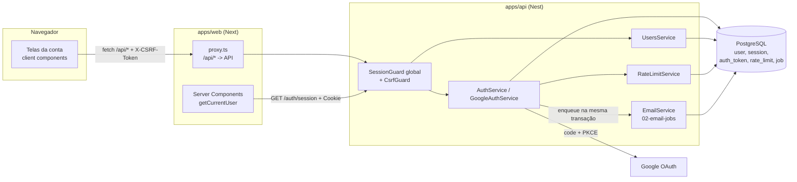

# Auth Design

**Spec**: `.specs/features/03-auth/spec.md`
**Status**: Approved
**Approved**: 2026-11-19 - user: "Aprovado." (inclui os 10 padrões propostos no design)

---

## Architecture Overview

A API ganha três módulos: `users` (conta e perfil), `auth` (sessão, links por e-mail, Google, CSRF, guard global) e `rate-limit` (contagens no PostgreSQL). O site ganha as telas da conta como client components que chamam `/api/*` pelo `proxy.ts` (AD-006); o `Set-Cookie` da API passa pelo proxy e chega ao navegador na origem do site. Server Components leem o usuário chamando `GET /auth/session` pela URL interna, com o cookie da requisição repassado.



Fluxo do login com Google:

```mermaid
sequenceDiagram
    participant B as Navegador
    participant W as Next (proxy)
    participant A as API
    participant G as Google
    B->>W: GET /api/auth/google/start?next=/convite/x
    W->>A: repassa
    A-->>B: 302 para o Google + cookie assinado g_oauth (state, verifier, next; 10 min)
    B->>G: consentimento
    G-->>B: 302 WEB_URL/api/auth/google/callback?code&state
    B->>W: GET callback
    W->>A: repassa (com o cookie g_oauth)
    A->>G: POST token endpoint (code, code_verifier, client secret)
    G-->>A: id_token (sub, email, email_verified, name, picture)
    alt conta já vinculada ou e-mail verificado com conta
        A-->>B: 302 next + cookie de sessão
    else e-mail verificado sem conta
        A-->>B: 302 /completar-cadastro + cookie assinado g_signup (15 min)
        B->>A: POST /auth/google/complete (nome, termos, marketing)
        A-->>B: 200 + cookie de sessão
    else e-mail não verificado ou retorno inválido
        A-->>B: 302 /entrar?erro=...
    end
```

As regras que mudam o que a pessoa vê (validação, enumeração, limites, validade dos links, vínculo do Google, destino seguro) rodam na API e em funções puras do site (`safe-next`, `in-app-browser`), todas cobertas por testes de unidade ou integração.

---

## Code Reuse Analysis

### Existing Components to Leverage

| Component | Location | How to Use |
| --- | --- | --- |
| `EmailService.enqueue` | `apps/api/src/email/email.service.ts` | Todos os e-mails da `auth`, com o `EntityManager` da transação de origem e blocos parágrafo e botão |
| `BusinessEventsService` | `apps/api/src/observability/business-events.service.ts` | `user.registered` e `user.email_verified` |
| `validateEnvironment` | `apps/api/src/config/env.validation.ts` | Variáveis novas, no mesmo padrão `ValidateIf(isProduction)` de `RESEND_API_KEY` |
| `ValidationPipe` global e `AllExceptionsFilter` | `apps/api/src/app.setup.ts` | DTOs com `class-validator`; 400, 401, 403 e 429 pelo filtro existente |
| Padrão de entidade e migration | `apps/api/src/jobs/job.entity.ts`, `database/migrations/` | Entidades novas e uma migration gerada (AD-004) |
| `fake-resend.ts`, `isolated-database.ts` | `apps/api/test/` | Servidor HTTP falso para o Google no mesmo molde; banco isolado por teste |
| `proxy.ts` | `apps/web/src/proxy.ts` | Sem mudança de mecanismo; o `Set-Cookie` da API já volta ao navegador |
| `AppHeader` | `apps/web/src/components/app-header.tsx` | Ganha o botão "Entrar" ou o menu do avatar |
| `initSentry` | `apps/api/src/instrument.ts` | Já descarta cookies, cabeçalhos e corpos; o teste de sigilo confere |

### Integration Points

| System | Integration Method |
| --- | --- |
| `job` / Resend | `EmailService.enqueue(message, { manager })` dentro da transação de cadastro, troca de senha etc. |
| Google | `fetch` nos endpoints de autorização e de token; URLs configuráveis para o teste usar um Google falso |
| Features seguintes | `@Public()`, `@CurrentUser()` e o `SessionGuard` global; `RateLimitService.consume()` para limitar as próprias rotas |
| Site | `GET /auth/session` (Server Components e client), `apiFetch` com `X-CSRF-Token` |

---

## Components

### API: `users`

- **Purpose**: Conta do usuário e perfil.
- **Location**: `apps/api/src/users/`
- **Interfaces**:
  - `UsersService.findByEmail(email: string, manager?): Promise<User | null>` - e-mail normalizado (trim + minúsculas).
  - `UsersService.updateProfile(userId, { name?, marketingOptIn? }): Promise<User>` - grava `marketingOptInAt` quando o opt-in muda.
  - `UsersController`: `GET /users/me`, `PATCH /users/me`, `POST /users/me/password`, `POST /users/me/email`.
- **Dependencies**: TypeORM, `PasswordHasher`, `SessionsService`, `AuthTokensService`, `EmailService`. O `UsersModule` importa o `AuthModule`, que exporta esses serviços e registra o repositório de `User` sem importar o `UsersModule`.
- **Reuses**: padrão de entidade do `job`.

### API: `PasswordHasher`

- **Purpose**: Hash e verificação de senha com argon2id nativo.
- **Location**: `apps/api/src/auth/password-hasher.ts`
- **Interfaces**:
  - `hash(password: string): Promise<string>` - formato PHC `$argon2id$v=19$m=19456,t=2,p=1$<salt>$<hash>`.
  - `verify(password: string, stored: string | null): Promise<boolean>` - com `stored` nulo (conta inexistente ou só Google) verifica contra um hash fixo, para o tempo de resposta não revelar a conta; compara com `timingSafeEqual`.
- **Dependencies**: `node:crypto` (`argon2`, `randomBytes`, `timingSafeEqual`).

### API: `SessionsService`

- **Purpose**: Abrir, ler, renovar e encerrar sessões.
- **Location**: `apps/api/src/auth/sessions.service.ts`
- **Interfaces**:
  - `create(userId, response, manager?): Promise<void>` - token de 32 bytes aleatórios em base64url no cookie `sid`; grava o SHA-256 dele; emite um token CSRF novo.
  - `resolve(rawToken): Promise<{ session, user } | null>` - ignora sessão com `expiresAt` no passado.
  - `touch(session, response, rawToken)` - se o último uso tem mais de 1 hora, grava `lastUsedAt`, `expiresAt = agora + 30 dias` e reenvia o cookie com o novo `Max-Age`.
  - `revoke(sessionId)`, `revokeAll(userId, { except?: sessionId }, manager?)`.
- **Cookie `sid`**: `HttpOnly`, `SameSite=Lax`, `Path=/`, `Secure` quando `NODE_ENV=production`, `Max-Age` 30 dias.

### API: `AuthTokensService`

- **Purpose**: Links de uso único enviados por e-mail.
- **Location**: `apps/api/src/auth/auth-tokens.service.ts`
- **Interfaces**:
  - `issue(userId, type, { newEmail?, next? }, manager): Promise<string>` - apaga os tokens não usados do mesmo tipo e usuário, grava o SHA-256 do novo e devolve o valor bruto para o link.
  - `consume(rawToken, type, manager): Promise<AuthToken | null>` - `SELECT ... FOR UPDATE`; nulo se vencido, usado ou inexistente; marca `usedAt`.
- **Tipos**: `email_verification` (7 dias), `password_reset` (1 hora), `email_change` (7 dias); a validade é do tipo, definida no serviço.

### API: `AuthService` e `AuthController`

- **Purpose**: Cadastro, confirmação, login, logout, recuperação.
- **Location**: `apps/api/src/auth/`
- **Rotas** (todas `@Public()`, exceto as marcadas):
  - `GET /auth/session` - `{ user: SessionUser | null }`; garante o cookie `csrf`.
  - `POST /auth/register` - sempre `202 { email }`; transação: cria a conta e enfileira a confirmação, ou enfileira o aviso "já tem conta".
  - `POST /auth/login` - `200 { user }` + cookies; `401` "E-mail ou senha incorretos.".
  - `POST /auth/logout` (autenticada) - `204`, encerra a sessão e apaga `sid`.
  - `POST /auth/logout-all` (autenticada) - `204`, encerra todas.
  - `POST /auth/email/verify` `{ token }` - confirma, emite `user.email_verified`, abre sessão, devolve `{ next }`.
  - `POST /auth/email/verification-link` (autenticada) - `202 { email }`; pede um novo link de confirmação.
  - `POST /auth/password/forgot` `{ email }` - sempre `202`.
  - `POST /auth/password/reset` `{ token, password }` - troca, confirma o e-mail, `revokeAll`, abre sessão, avisa, devolve `{ next }`.
  - `POST /auth/email/change/confirm` `{ token }` - troca o e-mail; `409` "Este e-mail já está em uso por outra conta.".
- **Links nos e-mails**: `WEB_URL` + `/confirmar-email?token=...`, `/redefinir-senha?token=...`, `/confirmar-email?token=...&tipo=troca`. A página do site faz o `POST`; o `GET` do link não muda nada, para leitores de link de antivírus não gastarem o token.
- **Corrida no cadastro**: o índice único de `email` decide, por `INSERT ... ON CONFLICT (email) DO NOTHING`; sem linha devolvida, a mesma transação segue o caminho "já tem conta".
- **Destino**: `safeNext` da API em `src/auth/safe-next.ts`, com as regras do `safeNext` do site; o cadastro grava no token o destino já validado.
- **Versão dos termos**: `TERMS_VERSION` em `packages/shared`.

### API: `GoogleAuthService` e `GoogleAuthController`

- **Purpose**: Login com Google por OIDC manual (decisão do usuário).
- **Location**: `apps/api/src/auth/google/`
- **Rotas** (`@Public()`):
  - `GET /auth/google/start?next=` - 302 para `GOOGLE_AUTH_URL` com `client_id`, `redirect_uri=WEB_URL/api/auth/google/callback`, `scope=openid email profile`, `state`, `code_challenge` (S256); cookie assinado `g_oauth` por 10 min.
  - `GET /auth/google/callback?code&state` - confere `state` com o cookie, troca o code em `GOOGLE_TOKEN_URL`, decodifica o `id_token` e confere `aud`, `iss` e `exp`; segue os ramos do diagrama.
  - `POST /auth/google/complete` `{ name, acceptTerms, marketingOptIn }` - lê `g_signup`; se o e-mail ganhou conta nesse meio-tempo, vincula em vez de criar.
  - `GET /auth/google/signup` - devolve `{ name, email }` do `g_signup` válido, para a tela "Complete seu cadastro" preencher o nome; `401` sem ele.
- **Cookies assinados**: `g_oauth` e `g_signup` levam JSON em base64url com HMAC-SHA256 por `AUTH_SECRET`, `HttpOnly`, `SameSite=Lax`, `Path=/api/auth/google` (o `g_signup` com `Path=/`).
- **Configuração**: `GOOGLE_CLIENT_ID`, `GOOGLE_CLIENT_SECRET` (obrigatórias em produção), `GOOGLE_AUTH_URL` e `GOOGLE_TOKEN_URL` com os endereços do Google como padrão.

### API: `SessionGuard`, `CsrfGuard`, decorators

- **Purpose**: Autenticação por padrão e proteção contra CSRF para todas as features.
- **Location**: `apps/api/src/auth/guards/`, `apps/api/src/auth/decorators/`
- **Interfaces**:
  - `@Public()` - libera a rota do `SessionGuard`; `health` passa a usá-lo.
  - `@CurrentUser()` - injeta o `SessionUser` da requisição.
  - `SessionGuard` (global, `APP_GUARD`) - lê `sid`, chama `resolve` e `touch`; sem sessão numa rota não pública, `401`.
  - `CsrfGuard` (global, depois do `SessionGuard`) - em `POST`, `PUT`, `PATCH` e `DELETE`, exige `X-CSRF-Token` igual ao cookie `csrf` e com HMAC válido para a sessão atual (ou para a ausência dela); senão `403`. Não se aplica ao `GET` do callback do Google, protegido pelo `state`.
- **Token CSRF**: `<aleatório>.<HMAC(AUTH_SECRET, aleatório + id da sessão ou "anon")>`, cookie `csrf` legível pelo site (`SameSite=Lax`, `Path=/`). É emitido por `GET /auth/session` e trocado sempre que a sessão abre ou fecha.

### API: `RateLimitService`

- **Purpose**: Limites de tentativas somados entre instâncias.
- **Location**: `apps/api/src/rate-limit/`
- **Interfaces**:
  - `consume(key: string, limit: number, windowMs: number): Promise<{ allowed: boolean; retryAfterMs: number }>` - um `INSERT ... ON CONFLICT (key) DO UPDATE` que reinicia a contagem quando a janela venceu e soma 1 senão, devolvendo a contagem e o início da janela.
  - `assertWithinLimits(rules: RateRule[])` - consome todas as regras e lança `429` com "Muitas tentativas. Tente de novo em N minutos." ("em 1 minuto." quando N = 1) (N = minutos restantes arredondados para cima) se alguma estourou.
- **Chaves**: `<rota>:email:<SHA-256 do e-mail normalizado>` e `<rota>:ip:<ip>`; o e-mail não fica em claro na tabela.
- **IP do cliente**: o Next repassa os cabeçalhos da requisição sem acrescentar `X-Forwarded-For` (só `x-forwarded-host`). A API usa o `trust proxy` do Express com `TRUST_PROXY_HOPS` saltos e lê `request.ip`.
- **Reuses**: nenhuma dependência; uma linha por chave, sem limpeza (fica na `10-lifecycle`).

### API: e-mails da `auth`

- **Purpose**: Montar os 7 e-mails em blocos parágrafo e botão.
- **Location**: `apps/api/src/auth/auth-emails.ts`
- **Interfaces**: uma função por e-mail que devolve `EmailMessage`, com os assuntos e botões aprovados na spec.

### Web: sessão e chamadas

- **Location**: `apps/web/src/lib/`
- **Interfaces**:
  - `getCurrentUser(): Promise<SessionUser | null>` (servidor) - `GET API_INTERNAL_URL/auth/session` com o cabeçalho `Cookie` da requisição, `cache: 'no-store'`.
  - `requireUser(path: string)` (servidor) - sem usuário, `redirect('/entrar?next=' + path)`.
  - `apiFetch(path, init)` (cliente) - lê o cookie `csrf` (busca `/api/auth/session` se faltar), manda `X-CSRF-Token`, e num `401` leva a `/entrar?next=<caminho atual>`.
  - `safeNext(value): string` - aceita só caminho que começa com `/`, não com `//` nem `/\`, sem esquema, e que não é `/entrar` nem `/cadastro`; senão `/perfil`.
  - `isInAppBrowser(userAgent): boolean` - WhatsApp, Instagram (`Instagram`), Facebook (`FBAN`, `FBAV`).

### Web: telas

- **Location**: `apps/web/src/app/`
- `entrar/`, `cadastro/`, `esqueci-a-senha/`, `redefinir-senha/`, `confirmar-email/`, `completar-cadastro/`, `perfil/`, `termos/`, `privacidade/`.
- `components/user-menu.tsx` (avatar com menu "Perfil" e "Sair"), `components/email-verification-banner.tsx`, `components/google-button.tsx` (esconde-se sem Google configurado; vira a orientação no navegador interno).
- Componentes do shadcn adicionados: `button`, `input`, `label`, `checkbox`, `dropdown-menu`, `avatar`, `alert`, com os tokens do design system.

---

## Data Models

Colunas em camelCase, como no `job`. Conjuntos fechados de valores são uniões de strings em `snake_case` (`.claude/rules/nest-api-coding-standards.md`); o `JobStatus` em maiúsculas foi uma exceção da `02-email-jobs`.

### User (`user`)

```typescript
type User = {
  id: string; // uuid
  name: string; // varchar(80)
  email: string; // varchar(254), único, normalizado (trim + minúsculas)
  passwordHash: string | null; // PHC argon2id
  googleId: string | null; // varchar(255), único
  avatarUrl: string | null; // foto do Google
  emailVerifiedAt: Date | null;
  termsVersion: string; // ex.: "2026-11-19"
  termsAcceptedAt: Date;
  marketingOptIn: boolean;
  marketingOptInAt: Date | null; // última mudança do opt-in
  createdAt: Date;
  updatedAt: Date;
};
```

O `deletedAt` do `scope.md` 6 fica para a `11-account-deletion`.

### Session (`session`)

```typescript
type Session = {
  id: string; // uuid
  userId: string; // FK user, ON DELETE CASCADE, índice
  tokenHash: string; // char(64), SHA-256 hex, único
  createdAt: Date;
  lastUsedAt: Date;
  expiresAt: Date; // lastUsedAt + 30 dias
};
```

### AuthToken (`auth_token`)

```typescript
type AuthTokenType = 'email_verification' | 'password_reset' | 'email_change';

type AuthToken = {
  id: string; // uuid
  userId: string; // FK user, ON DELETE CASCADE
  type: AuthTokenType;
  tokenHash: string; // char(64), único
  newEmail: string | null; // só email_change
  next: string | null; // destino depois da confirmação, já passado por safeNext
  expiresAt: Date;
  usedAt: Date | null;
  createdAt: Date;
};
```

### RateLimit (`rate_limit`)

```typescript
type RateLimit = {
  key: string; // varchar(300), PK
  windowStart: Date;
  count: number;
};
```

`SessionUser` (exportado por `packages/shared`): `{ id, name, email, avatarUrl, emailVerified: boolean, hasPassword: boolean, hasGoogle: boolean, marketingOptIn: boolean }`. Nenhum hash sai da API.

---

## Error Handling Strategy

| Error Scenario | Handling | User Impact |
| --- | --- | --- |
| Validação do DTO | `400` do `ValidationPipe` | Mensagem no campo |
| Login inválido, conta só Google | `401` "E-mail ou senha incorretos.", depois de `verify` contra o hash fixo | Mesma mensagem e mesmo tempo |
| Sem sessão numa rota protegida | `401` | Site leva a `/entrar?next=` |
| CSRF ausente ou inválido | `403` | `apiFetch` busca um token novo e repete uma vez; falhando, "Algo deu errado. Recarregue a página." |
| Limite estourado | `429` com a mensagem e `Retry-After` | "Muitas tentativas. Tente de novo em N minutos." ("em 1 minuto." quando N = 1) |
| Link vencido, usado ou substituído | `410` | "Este link expirou ou já foi usado." |
| Troca para e-mail em uso | `409` | "Este e-mail já está em uso por outra conta." |
| Google: state diferente, code recusado, token inválido, cancelamento | 302 `/entrar?erro=google` | "Não foi possível entrar com Google. Tente de novo." |
| Google: e-mail não verificado | 302 `/entrar?erro=google_nao_verificado` | "Não foi possível entrar com Google. Entre com e-mail e senha." |
| Google fora do ar ou lento | `fetch` com timeout de 10 s; vira o caso `erro=google` | Mesma mensagem |
| Falha ao enfileirar e-mail | A transação inteira desfaz; `500` | "Algo deu errado. Tente de novo." |

---

## Risks & Concerns

| Concern | Location (file:line) | Impact | Mitigation |
| --- | --- | --- | --- |
| IP do cliente atrás do Next | `apps/web/src/proxy.ts:11` | O Next não acrescenta `X-Forwarded-For`; sem `TRUST_PROXY_HOPS` certo, todo mundo divide o IP do servidor do Next e o limite de 30 logins por IP vale para o site inteiro | `TRUST_PROXY_HOPS` obrigatória em produção; o deploy (hospedagem ainda em aberto, `scope.md` 12.2) define o valor; teste de integração com `X-Forwarded-For` |
| API acessível direto pela internet | hospedagem | Um cliente forja `X-Forwarded-For` e escapa do limite por IP; o limite por e-mail continua | Registrar no deploy que a API fica só na rede interna; o limite por e-mail não depende do IP |
| Rotas existentes ficam fechadas com o guard global | `apps/api/src/health/health.controller.ts` | `GET /health` passaria a responder 401 e o site mostraria "API indisponível" | `@Public()` no health na mesma task do guard; o teste do health continua no gate |
| Testes de integração existentes com `POST` | `apps/api/test/*.int-spec.ts` | O `CsrfGuard` global pode quebrar fixtures que fazem `POST` | As fixtures montam módulos próprios sem o guard; conferir na task do guard com a suíte inteira |
| Tabelas sem limpeza | `session`, `auth_token`, `rate_limit` | Crescem até a `10-lifecycle` | Uma linha por chave no `rate_limit`; `auth_token` substitui os não usados do mesmo tipo; registrado como ideia adiada |
| ID token sem validar assinatura | `GoogleAuthService` | Seguro só porque vem direto do endpoint de token por HTTPS com o client secret (documentação do Google) | O token nunca é aceito de outra origem; `aud`, `iss` e `exp` conferidos mesmo assim |
| `crypto.argon2` é recente no Node | `PasswordHasher` | Mudança de API numa versão futura do Node | `engines.node` fixo em 26; teste de unidade de hash e verificação |
| Enumeração por tempo de resposta | login, cadastro, recuperação | O ramo "e-mail existe" pode demorar mais | Login verifica sempre contra um hash; cadastro e recuperação só enfileiram (mesmo trabalho nos dois ramos); sem promessa de tempo idêntico além disso |

---

## Tech Decisions (only non-obvious ones)

| Decision | Choice | Rationale |
| --- | --- | --- |
| Sessão | Tabela `session`, cookie `sid` com token aleatório, hash SHA-256 no banco (AD-011) | Decisão do usuário |
| Hash de token (sessão e links) | SHA-256 sem sal | Tokens de 32 bytes aleatórios não precisam de hash lento |
| Parâmetros do argon2id | `m=19456` (19 MiB), `t=2`, `p=1`, sal de 16 bytes, saída de 32 bytes | Mínimo recomendado pela OWASP |
| Renovação da sessão | Grava `lastUsedAt` no máximo 1 vez por hora | Evita um `UPDATE` por requisição; a expiração fica entre 29 dias e 23 h e 30 dias depois do último uso |
| Segredo de assinatura | `AUTH_SECRET` (CSRF e cookies do Google), obrigatória em produção, com padrão fixo fora dela | Um segredo só para HMAC |
| Leitura de cookies | Função própria sobre o cabeçalho `Cookie`; escrita pelo `res.cookie` do Express | Evita a dependência `cookie-parser` |
| Link do e-mail | A página do site faz o `POST`; o `GET` não muda nada | Leitores de link não gastam o token |
| Rota de "Complete seu cadastro" | `/completar-cadastro` | A spec não nomeava a rota |
| URL pública | `WEB_URL` (spec) também forma o `redirect_uri` do Google | Callback na origem do site, pelo proxy |
| Registro dos guards | `APP_GUARD` no `AuthModule` | As features só usam os decorators |

> **Project-level decisions:** `@Public()` por padrão, CSRF por `X-CSRF-Token` e `RateLimitService` estão no `.specs/STATE.md` como AD-012 a AD-014.
