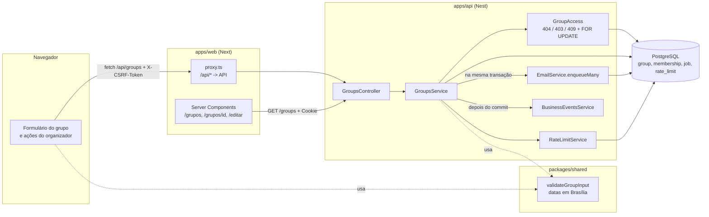

# Groups Design

**Spec**: `.specs/features/04-groups/spec.md`
**Status**: Approved
**Approved**: 2026-11-21 - user: "Design aprovado." (inclui os 11 padrões propostos no design)
**Amended**: 2026-11-21 - nas Tasks: os status de grupo e de participação ficam em maiúsculas (`OPEN`, `DRAWN`, `CLOSED`; `PENDING`, `APPROVED`, `REJECTED`), como o `JobStatus`, fora da regra de `snake_case` de `.claude/rules/` - user: "Maiúsculas, como no design", entre essa e "snake_case minúsculo (Recomendado)".
**Project decisions**: AD-015 (validação no `packages/shared` com 400 por campo) e AD-016 (`GroupAccess` com trava da linha), estendidas às features 05 a 09 - user: "As features 05 a 09 podem seguir o mesmo padrão."

---

## Architecture Overview

A API ganha o módulo `groups` (entidades `Group` e `Membership`, serviço, controller e o `GroupAccess`, que decide 404, 403 e 409 dentro da transação). As regras dos campos ficam numa função pura do `packages/shared`, usada pelo formulário do site antes de enviar e pela API antes de gravar. O site ganha as telas em `/grupos`: Server Components leem os grupos pela URL interna da API com o cookie da requisição (como o `getSession` da `03-auth`), e client components fazem as mutações por `apiFetch` (CSRF, AD-013).



Excluir ou encerrar:

```mermaid
sequenceDiagram
    participant B as Navegador
    participant A as API (GroupsService)
    participant D as PostgreSQL
    B->>A: DELETE /groups/:id (ou POST /groups/:id/close)
    A->>D: BEGIN; SELECT group FOR UPDATE
    alt grupo não existe ou pessoa não é participante aprovada
        A-->>B: 404 "Grupo não encontrado."
    else não organiza
        A-->>B: 403 "Só quem organiza pode alterar o grupo."
    else encerrar e status != DRAWN
        A-->>B: 409 "Só um grupo sorteado pode ser encerrado."
    else permitido
        A->>D: lê participantes aprovados (menos o organizador)
        A->>D: INSERT de um job email.send por pessoa (uma instrução)
        A->>D: DELETE group (participações em cascata) ou UPDATE status = CLOSED, closedAt = now()
        A->>D: COMMIT
        A->>A: group.deleted / group.closed
        A-->>B: 204 (excluir) ou 200 com o grupo (encerrar)
    end
```

Um segundo pedido simultâneo espera a trava da linha: na exclusão, encontra o grupo apagado (404); no encerramento, encontra CLOSED (409). Os e-mails saem uma vez só.

**Onde as regras rodam.** Validação dos campos e mensagens: `packages/shared` (testes de unidade) e API (testes de integração). Quem vê o quê, seções, ordem e contagem de participantes de "Meus grupos": API (consulta SQL, testes de integração). Texto da data do card, formato do valor, rótulo de participantes, botões por status e papel: funções puras e componentes do site (testes de unidade e de componente). Nada é filtrado, ordenado ou contado no navegador.

---

## Code Reuse Analysis

### Existing Components to Leverage

| Component | Location | How to Use |
| --- | --- | --- |
| `SessionGuard` global, `@CurrentUser()` | `apps/api/src/auth/guards/session.guard.ts`, `decorators/` | Todas as rotas de grupo exigem sessão (AD-012); o usuário chega por `@CurrentUser()` |
| `CsrfGuard` global | `apps/api/src/auth/guards/csrf.guard.ts` | `POST`, `PUT` e `DELETE` de grupo já exigem o token (AD-013) |
| `RateLimitService`, `rateLimitKey`, `TooManyAttemptsException` | `apps/api/src/rate-limit/` | `groups.create` por `user`, 20 por hora; a mensagem e o `Retry-After` já existem |
| `EmailService`, `JobQueue` | `apps/api/src/email/email.service.ts`, `jobs/job-queue.service.ts` | Ganha `enqueueMany`, com as mesmas checagens de destinatário e URL |
| Blocos `paragraph`/`button`, `escapeHtml` | `apps/api/src/auth/auth-emails.ts`, `email/email-layout.ts` | E-mails de grupo no mesmo molde (saudação, texto, botão); o layout já escapa HTML |
| `BusinessEventsService` | `apps/api/src/observability/business-events.service.ts` | `group.created`, `group.updated`, `group.closed`, `group.deleted` |
| `AllExceptionsFilter` | `apps/api/src/observability/all-exceptions.filter.ts` | Devolve o corpo da `HttpException`, então o 400 com `fields` passa sem mudança |
| `NameLength` (pontos de código) | `apps/api/src/users/name-length.ts` | Mesma medida no validador do shared (`[...texto].length`) |
| Padrão de entidade e migration | `apps/api/src/users/user.entity.ts`, `jobs/job.entity.ts`, `database/migrations/` | Entidades novas e uma migration gerada (AD-004); status em `varchar` como o do `job` |
| `isolated-database.ts`, `account-env.ts` | `apps/api/test/` | Banco isolado por teste; contas e sessão nos testes de integração |
| `getSession`, `requireUser` | `apps/web/src/lib/session.ts` | Proteção das páginas e molde do fetch do servidor com cookie |
| `apiFetch` | `apps/web/src/lib/api-fetch.ts` | Mutações do site com CSRF e 401 levando a `/entrar` |
| `safeNext` (API e site) | `apps/api/src/auth/safe-next.ts`, `apps/web/src/lib/safe-next.ts` | `DEFAULT_NEXT` passa a `/grupos` |
| `UserMenuDropdown` | `apps/web/src/components/user-menu-dropdown.tsx` | Ganha "Meus grupos" como primeiro item |
| `Button`, `Input`, `Label`, `Checkbox`, `Alert`, `FieldError` | `apps/web/src/components/` | Formulário e estados das telas |
| `@base-ui/react/dialog` (já instalado) | `apps/web/node_modules/@base-ui/react/dialog` | Base do `dialog` do shadcn, sem dependência nova; fecha com Esc e com toque fora (`disablePointerDismissal` padrão `false`, docs do Base UI 1.9.0) |
| `e2e/support/account.ts`, `fixtures.ts`, `accessibility.spec.ts` | `apps/web/e2e/` | Conta logada, caixa de e-mails falsa e o molde do axe e das larguras |

### Integration Points

| System | Integration Method |
| --- | --- |
| `job` / e-mail | `EmailService.enqueueMany(messages, { manager })` na transação de excluir e encerrar |
| `rate_limit` | `consume` depois da validação, antes de gravar: só criações válidas contam |
| Features seguintes | `GroupAccess.requireMember` / `requireOrganizer` para rotas dentro de um grupo; `Membership.status` já com `PENDING` e `REJECTED` para a `05-invites`; `Group.ownerId` para a transferência |
| Site | `GET /groups`, `GET /groups/:id` nos Server Components; `POST`, `PUT`, `DELETE`, `POST .../close` pelo `apiFetch` |

---

## Components

### Shared: regras e formatos do grupo

- **Purpose**: Regras dos campos do grupo, mensagens em português e conversão de datas no horário de Brasília, para o site e a API.
- **Location**: `packages/shared/src/groups.ts` (exportado no `index.ts`)
- **Interfaces**:
  - `type GroupStatus = 'OPEN' | 'DRAWN' | 'CLOSED'`
  - `type GroupInput = { name: string; description: string | null; giftMinValue: number | null; giftMaxValue: number | null; drawScheduledAt: string | null; eventAt: string | null; eventLocation: string | null; isOnlineEvent: boolean; requiresApproval: boolean }` - datas em ISO 8601 com fuso.
  - `normalizeGroupInput(input: GroupInput): GroupInput` - tira os espaços das pontas de nome, recado e local; texto vazio vira `null`; só `giftMinValue` preenchido grava `giftMaxValue` igual.
  - `validateGroupInput(input: GroupInput, options: { now: Date; saved?: { drawScheduledAt: string | null; eventAt: string | null } }): GroupFieldErrors` - recebe a entrada já normalizada; devolve `{}` quando válido. Uma data igual à gravada (mesmo instante) não passa pela regra do futuro.
  - `type GroupFieldErrors = Partial<Record<'name' | 'description' | 'giftMinValue' | 'giftMaxValue' | 'drawScheduledAt' | 'eventAt' | 'eventLocation', string>>`
  - `GROUP_MESSAGES` - as mensagens da spec (GRP-01 AC 5 a 12).
  - `brasiliaInputToIso(value: string): string` - `2026-12-20T19:00` (valor do `datetime-local`) para ISO com o deslocamento de `America/Sao_Paulo` naquele instante, calculado por `Intl.DateTimeFormat`.
  - `isoToBrasiliaInput(iso: string): string` - o inverso, para preencher o formulário de edição.
  - `formatBrasiliaDateTime(iso: string): string` - `20/12/2026 às 19:00`; `formatBrasiliaDate(iso: string): string` - `20/12/2026`.
  - Tipos de resposta: `GroupSummary`, `MyGroupsResponse`, `GroupDetail` (ver Data Models).
- **Dependencies**: nenhuma; `Intl` do Node e do navegador.
- **Reuses**: medida em pontos de código do `NameLength`.

### API: `GroupsModule`

- **Purpose**: Rotas, regras de negócio e persistência dos grupos.
- **Location**: `apps/api/src/groups/`
- **Interfaces** (`GroupsController`, prefixo `groups`):
  - `POST /groups` → 201 `GroupDetail`
  - `GET /groups` → 200 `MyGroupsResponse`
  - `GET /groups/:id` → 200 `GroupDetail`
  - `PUT /groups/:id` → 200 `GroupDetail` (substitui todos os campos; campo `null` apaga)
  - `POST /groups/:id/close` → 200 `GroupDetail`
  - `DELETE /groups/:id` → 204
- **`GroupsService`**:
  - `create(user, input)` - normaliza e valida (400 com `fields`); `rateLimit.assertWithinLimits([{ key: rateLimitKey('groups.create', 'user', user.id), limit: 20, windowMs: 3_600_000 }])`; numa transação grava o `Group` (OPEN, `ownerId`) e a `Membership` APPROVED do organizador; depois do commit, `group.created`.
  - `listMine(userId)` - uma consulta: participações APPROVED da pessoa, com a contagem de participantes aprovados por grupo; `active` (OPEN, DRAWN) e `closed` (CLOSED), cada lista por `createdAt` decrescente.
  - `get(userId, id)` - `requireMember`; devolve `GroupDetail` com `owner` e `isOrganizer`.
  - `update(userId, id, input)` - transação: `requireOrganizer(..., { lock: true })`; CLOSED → 409; normaliza e valida com `saved`; grava; depois do commit, `group.updated` com os campos que mudaram (se algum mudou).
  - `close(userId, id)` - transação: `requireOrganizer` com trava; status ≠ DRAWN → 409; `status = CLOSED`, `closedAt = now()`; e-mails; depois do commit, `group.closed` (`trigger: "manual"`).
  - `remove(userId, id)` - transação: `requireOrganizer` com trava; e-mails; `DELETE`; depois do commit, `group.deleted` (`status`).
- **`GroupAccess`** (`group-access.service.ts`, exportado para as features seguintes):
  - `requireMember(userId, groupId, options?: { manager?: EntityManager; lock?: boolean }): Promise<{ group: Group; membership: Membership }>` - id que não é UUID, grupo inexistente ou sem participação APPROVED → `NotFoundException('Grupo não encontrado.')`; com `lock`, `SELECT ... FOR UPDATE` na linha do grupo.
  - `requireOrganizer(userId, groupId, options?)` - `requireMember` e, se `group.ownerId !== userId`, `ForbiddenException('Só quem organiza pode alterar o grupo.')`.
- **Ordem das recusas**: 404 → 403 → 409 → 400 → 429. Assim uma pessoa de fora nunca descobre nada pelo tipo do erro.
- **DTO**: `GroupInputDto` com `class-validator` só para o formato (tipos, inteiros, ISO 8601, booleanos, sem campos extras); falha de formato é 400 genérico do `ValidationPipe`, que só um cliente fora do site produz. As regras de negócio e as mensagens vêm do `validateGroupInput`, lançadas como `GroupValidationException` (400): `{ statusCode: 400, message: 'Dados inválidos.', error: 'Bad Request', fields: GroupFieldErrors }`.
- **Dependencies**: TypeORM, `RateLimitModule`, `EmailModule`, `ObservabilityModule`, `ConfigService` (`WEB_URL`).
- **Reuses**: padrões do `users` (controller, DTO com `Transform(trim)`), `auth-emails.ts`.

### API: `group-emails.ts`

- **Purpose**: Montar os avisos de exclusão e de encerramento.
- **Location**: `apps/api/src/groups/group-emails.ts`
- **Interfaces**:
  - `groupDeletedEmail({ to, name, groupName, organizerName, webUrl }): EmailMessage` - assunto "O grupo {groupName} foi excluído"; blocos "Olá, {name}.", "{organizerName} excluiu o grupo {groupName} no Amigo Secreto. As informações do grupo foram apagadas." e o botão "Ver meus grupos" (`{webUrl}/grupos`).
  - `groupClosedEmail({ to, name, groupName, organizerName, groupId, webUrl }): EmailMessage` - assunto "O grupo {groupName} foi encerrado"; blocos "Olá, {name}.", "{organizerName} encerrou o grupo {groupName} no Amigo Secreto. Ele continua em Meus grupos, na seção Encerrados." e o botão "Ver grupo" (`{webUrl}/grupos/{groupId}`).
- **Reuses**: `paragraph`, `button`, `greeting` e `siteUrl` saem de `auth-emails.ts` para `email/email-blocks.ts`, usados pelos dois arquivos.

### API: `EmailService.enqueueMany`

- **Purpose**: Enfileirar muitos e-mails numa transação sem uma ida ao banco por e-mail.
- **Location**: `apps/api/src/email/email.service.ts`, `jobs/job-queue.service.ts`
- **Interfaces**:
  - `EmailService.enqueueMany(messages: EmailMessage[], options: { manager?: EntityManager }): Promise<void>` - as mesmas checagens do `enqueue` para cada mensagem, antes de gravar qualquer uma.
  - `JobQueue.enqueueMany(type, payloads, options)` - `INSERT` de várias linhas, em lotes de 1.000 (limite de parâmetros do PostgreSQL); lista vazia não toca o banco.

### Web: dados do servidor

- **Purpose**: Ler grupos da API nos Server Components com o cookie da requisição.
- **Location**: `apps/web/src/lib/groups.ts`
- **Interfaces**:
  - `getMyGroups(): Promise<MyGroupsResponse>` - lança erro em resposta ≠ 200.
  - `getGroup(id: string): Promise<GroupDetail | null>` - `null` no 404; lança erro nos outros.
- **Reuses**: o molde de `getSession` (`API_INTERNAL_URL`, `cookies()`, `no-store`, timeout de 5 s), extraído para `lib/api-server.ts` (`apiServerFetch(path)`) e usado pelos dois.

### Web: telas

- **`/grupos`** (`app/grupos/page.tsx`): `requireUser('/grupos')`; `getMyGroups()` dentro de `try`: na falha mostra "Não foi possível carregar seus grupos." e o botão "Tentar de novo" (`RetryButton`, client, chama `router.refresh()`). Seções "Ativos" e "Encerrados", estado vazio, botão "Criar grupo".
- **`/grupos/novo`** (`app/grupos/novo/page.tsx`): `requireUser`; `GroupForm` em modo criação.
- **`/grupos/[id]`** (`app/grupos/[id]/page.tsx`): `requireUser`; `getGroup`; `null` → `notFound()`, com `app/grupos/[id]/not-found.tsx` mostrando "Grupo não encontrado." e o link "Meus grupos". Mostra os dados e, para o organizador, `GroupActions`.
- **`/grupos/[id]/editar`** (`app/grupos/[id]/editar/page.tsx`): `requireUser`; `getGroup`; `null` → `notFound()`; não organizador ou CLOSED → `redirect('/grupos/{id}')`; `GroupForm` em modo edição.
- **`GroupForm`** (`app/grupos/group-form.tsx`, client): campos "Nome do grupo", "Recado para os participantes" (textarea), "Valor do presente (R$)", "Até (R$)", "Sorteio previsto" e "Confraternização" (`datetime-local`), "Local", "Evento online", "Exigir aprovação para entrar". Valida com `validateGroupInput` antes de enviar; mostra os `fields` de um 400 nos campos; 429 e erro inesperado num `Alert`; "Salvando..." com o botão desabilitado; "Voltar" na edição.
- **`GroupActions`** (`app/grupos/[id]/group-actions.tsx`, client): botões por status (GRP-03 AC 6 a 8); "Excluir grupo" e "Encerrar grupo" abrem o `ConfirmDialog`; ao confirmar, chama a API e navega (`/grupos` ou `router.refresh()`).
- **Componentes novos**: `components/ui/dialog.tsx` e `components/ui/textarea.tsx` (gerados pelo CLI do shadcn no estilo `base-vega`, sem pacote novo); `components/confirm-dialog.tsx` (ConfirmDialog do design system sobre o `Dialog` modal: foco inicial em "Manter grupo" pelo `initialFocus` do popup, Tab preso, Esc e toque fora desistem, `tone: "primary"` para encerrar); `components/status-tag.tsx`; `components/group-card.tsx` (card inteiro é link, "Você organiza").
- **Funções puras** (`lib/group-format.ts`): `formatGiftValue(min, max)`, `participantsLabel(count)`, `cardDateLine(summary)`.
- **Navegação**: `DEFAULT_NEXT = '/grupos'` no `safeNext` da API e do site; "Meus grupos" no `UserMenuDropdown`; `app/page.tsx` lê a sessão e, com usuário, `redirect('/grupos')`; se a leitura da sessão falha, mostra a página atual.

---

## Data Models

### Group (`group`)

```typescript
@Entity('group')
class Group {
  id: string;                     // uuid
  name: string;                   // varchar(80)
  description: string | null;     // varchar(1000)
  ownerId: string;                // uuid -> user.id, ON DELETE RESTRICT
  giftMinValue: number | null;    // integer
  giftMaxValue: number | null;    // integer
  drawScheduledAt: Date | null;   // timestamptz
  eventAt: Date | null;           // timestamptz
  eventLocation: string | null;   // varchar(200)
  isOnlineEvent: boolean;         // default false
  requiresApproval: boolean;      // default false
  status: 'OPEN' | 'DRAWN' | 'CLOSED'; // varchar, default 'OPEN'
  closedAt: Date | null;          // timestamptz
  createdAt: Date;
  updatedAt: Date;
}
```

Restrições no banco: `CHECK` do status; `CHECK ((giftMinValue IS NULL) = (giftMaxValue IS NULL))`; `CHECK (giftMinValue <= giftMaxValue)`; `CHECK ((status = 'CLOSED') = (closedAt IS NOT NULL))`. Índice em `ownerId`. O `varchar` do PostgreSQL conta pontos de código, a mesma medida do validador. `inviteCode` fica para a `05-invites`.

### Membership (`membership`)

```typescript
@Entity('membership')
class Membership {
  id: string;                     // uuid
  groupId: string;                // uuid -> group.id, ON DELETE CASCADE
  userId: string;                 // uuid -> user.id, ON DELETE RESTRICT
  status: 'PENDING' | 'APPROVED' | 'REJECTED'; // varchar
  joinedAt: Date;                 // timestamptz, default now()
}
```

Único `(groupId, userId)` (RN09); índice em `userId` para "Meus grupos"; `CHECK` do status. `ON DELETE RESTRICT` em `user` deixa a `11-account-deletion` decidir o destino das participações.

### Respostas (`packages/shared`)

```typescript
type GroupSummary = {
  id: string;
  name: string;
  status: GroupStatus;
  participantCount: number;       // participações APPROVED
  isOrganizer: boolean;
  drawScheduledAt: string | null;
  eventAt: string | null;
  createdAt: string;
};

type MyGroupsResponse = { active: GroupSummary[]; closed: GroupSummary[] };

type GroupDetail = {
  id: string;
  name: string;
  status: GroupStatus;
  description: string | null;
  giftMinValue: number | null;
  giftMaxValue: number | null;
  drawScheduledAt: string | null;
  eventAt: string | null;
  eventLocation: string | null;
  isOnlineEvent: boolean;
  requiresApproval: boolean;
  owner: { id: string; name: string };
  isOrganizer: boolean;
  closedAt: string | null;
  createdAt: string;
};
```

---

## Error Handling Strategy

| Error Scenario | Handling | User Impact |
| --- | --- | --- |
| Campo viola uma regra | `GroupValidationException` 400 com `fields` | Mensagem da spec embaixo do campo (o site já barra antes de enviar) |
| Corpo com formato errado (tipo, campo extra) | `ValidationPipe` 400 genérico | Só cliente fora do site; o formulário mostra "Não foi possível salvar. Tente de novo." |
| Grupo inexistente, id não UUID, pessoa de fora | `NotFoundException` 404 "Grupo não encontrado." | Página "Grupo não encontrado." com link "Meus grupos" |
| Participante que não organiza altera | `ForbiddenException` 403 | Não acontece pela tela (sem botões); `/editar` leva à página do grupo |
| Editar grupo ENCERRADO; encerrar grupo não SORTEADO | `ConflictException` 409 com a mensagem da spec | Mensagem num `Alert` |
| 21ª criação na hora | `TooManyAttemptsException` 429 + `Retry-After` | "Muitas tentativas. Tente de novo em N minutos." |
| API fora ao listar | `getMyGroups` lança; a página captura | "Não foi possível carregar seus grupos." + "Tentar de novo" |
| Falha no meio de excluir/encerrar | Transação desfeita: grupo, e-mails e evento ficam como antes | Mensagem genérica; nada pela metade |

---

## Risks & Concerns

| Concern | Location (file:line) | Impact | Mitigation |
| --- | --- | --- | --- |
| A página `/` passaria a ler a sessão, e `getSession` lança erro com a API fora | `apps/web/src/lib/session.ts:11`, `apps/web/src/app/page.tsx:9` | A página "API indisponível" e o e2e do servidor `web-api-down` quebrariam | `app/page.tsx` captura a falha da sessão e mostra a página atual; o e2e existente da API fora continua valendo |
| Testes da `03-auth` esperam `/perfil` como destino padrão | `apps/api/src/auth/safe-next.ts:1`, `apps/web/src/lib/safe-next.test.ts:10-25`, 26 ocorrências de `/perfil` em `apps/web/e2e/` | Suíte vermelha depois da troca para `/grupos` | A task da navegação atualiza os testes de destino padrão; os que abrem `/perfil` de propósito ficam |
| O `consume` do rate limit roda fora da transação de criação | `apps/api/src/rate-limit/rate-limit.service.ts:49` | Uma criação que falha no banco depois do `consume` conta no limite | Aceito: só acontece com erro de banco; documentado no serviço |
| Postgres recusa o cast de um id que não é UUID com erro 500 | `GroupAccess.requireMember` | Um `/grupos/abc` viraria 500 | `isUUID` antes da consulta → 404 |
| `INSERT` de muitos jobs estoura o limite de 65.535 parâmetros | `JobQueue.enqueueMany` | Grupo muito grande falharia ao excluir | Lotes de 1.000 linhas, todos na mesma transação |
| Conversão de horário sem biblioteca | `packages/shared/src/groups.ts` | Erro de deslocamento mostraria a festa uma hora fora | Deslocamento calculado pelo `Intl` no instante da data (cobre horário de verão se voltar); testes com datas fixas |
| Eventos emitidos antes do commit contariam operações desfeitas | `GroupsService` | Métrica errada | Evento só depois de a transação terminar (GRP-07 AC 6) |
| O menu do avatar ganha item; testes do cabeçalho conferem os itens | `apps/web/src/components/app-header.test.tsx`, `apps/web/e2e/header.spec.ts` | Testes desatualizados | Atualizados na task do menu |

---

## Tech Decisions (only non-obvious ones)

| Decision | Choice | Rationale |
| --- | --- | --- |
| Validação dos campos | Uma função `validateGroupInput(input, { now, saved })` no `packages/shared` devolve `{ campo: mensagem }`; o formulário usa antes de enviar e a API usa no serviço, respondendo 400 com os campos e as mesmas mensagens | Regra e texto num lugar só, testados uma vez - user: "Uma função no packages/shared (Recomendado)", entre essa, "Como na 03-auth" e "Só na API, com mensagens PT" |
| Quem organiza | `Group.ownerId`; o organizador também tem a participação `APPROVED` (RN02) | Um organizador por construção; transferir troca uma coluna - user: "Group.ownerId (Recomendado)", entre essa e "Papel na Membership" |
| Autorização | `GroupAccess.requireMember` / `requireOrganizer` no serviço, dentro da transação, com `SELECT ... FOR UPDATE` em editar, encerrar e excluir | A mesma leitura decide 404/403/409 e impede exclusão ou encerramento duplos - user: "No serviço, com trava da linha (Recomendado)", entre essa e "Guards com decorator" |
| Teste da tela de encerrar | Confirmação e botões por status em testes de componente (Vitest + Testing Library); transição, 409 e e-mails em testes de integração da API com grupo sorteado no banco; sem dependência nova | Nenhum grupo chega a SORTEADO pela API até a `06-draw` - user: "Teste de componente + integração da API (Recomendado)", entre essa e "e2e com o banco" |
| E-mails em lote | Um job `email.send` por pessoa, gravados num `INSERT` de várias linhas (`enqueueMany`) | Retry por e-mail e uma ida ao banco - user: "Um job por pessoa, num INSERT só (Recomendado)", entre essa, "Um job por pessoa, em laço" e "Um job que distribui depois" |
| Status da participação | `PENDING`, `APPROVED` e `REJECTED` já na migration desta feature | A `05-invites` não muda a tabela - user: "Os três status agora (Recomendado)", entre essa e "Só APPROVED agora" |
| Rotas da API | `POST /groups`, `GET /groups`, `GET /groups/:id`, `PUT /groups/:id` (substitui tudo), `POST /groups/:id/close`, `DELETE /groups/:id` | O formulário sempre manda o grupo inteiro; `PUT` deixa "campo vazio apaga" sem caso especial - padrão do agente, aprovado com o design, user: "Design aprovado." |
| Formato do 400 | `{ statusCode, message: 'Dados inválidos.', error, fields }` | O site põe cada mensagem no campo dela - padrão do agente, aprovado com o design, user: "Design aprovado." |
| Ordem das recusas | 404 → 403 → 409 → 400 → 429 | Quem está de fora só vê 404 - padrão do agente, aprovado com o design, user: "Design aprovado." |
| O que conta no limite | Só criações que passaram na validação | A spec conta grupos criados, não tentativas - padrão do agente, aprovado com o design, user: "Design aprovado." |
| Eventos | Depois do commit; `group.updated` só quando algum campo mudou, com `fields` em texto separado por vírgula (o serviço de eventos aceita só texto, número e booleano) | Nenhuma operação desfeita na métrica - padrão do agente, aprovado com o design, user: "Design aprovado." |
| Saudação dos e-mails | "Olá, {nome}." antes do texto da spec, como os e-mails da `03-auth` | Mesmo molde dos e-mails existentes - padrão do agente, aprovado com o design, user: "Design aprovado." |
| Datas | `datetime-local` no site; o shared converte para ISO com o deslocamento de Brasília; API grava `timestamptz`; exibição pelo `Intl` com `America/Sao_Paulo` | Sem biblioteca de datas - padrão do agente, aprovado com o design, user: "Design aprovado." |
| Chaves estrangeiras | `membership.groupId` em cascata; `group.ownerId` e `membership.userId` com `RESTRICT` | Exclusão do grupo leva as participações; exclusão de conta é da `11-account-deletion` - padrão do agente, aprovado com o design, user: "Design aprovado." |
| Falha ao listar | A própria página captura e mostra o erro com "Tentar de novo"; sem `error.tsx` | Mensagem da spec só em `/grupos`, não nas páginas filhas - padrão do agente, aprovado com o design, user: "Design aprovado." |
| Componentes de UI | `dialog` e `textarea` pelo CLI do shadcn (código copiado, sem pacote novo); `ConfirmDialog`, `StatusTag` e `GroupCard` seguindo o design system | O `@base-ui/react` já traz o `Dialog`. Usa `Dialog`, não `AlertDialog`: a spec pede que tocar fora desista (GRP-05 AC 2), e na documentação do Base UI 1.9.0 só o `Dialog` traz a opção de fechar com toque fora (`disablePointerDismissal`, padrão `false`); o `AlertDialog.Root` não tem essa prop - padrão do agente, aprovado com o design, user: "Design aprovado." |
| `requiresApproval` na resposta | Vai a todo participante; o site mostra "Entrada com aprovação" só para quem organiza | Não é segredo; a regra de exibição tem teste de componente - padrão do agente, aprovado com o design, user: "Design aprovado." |
