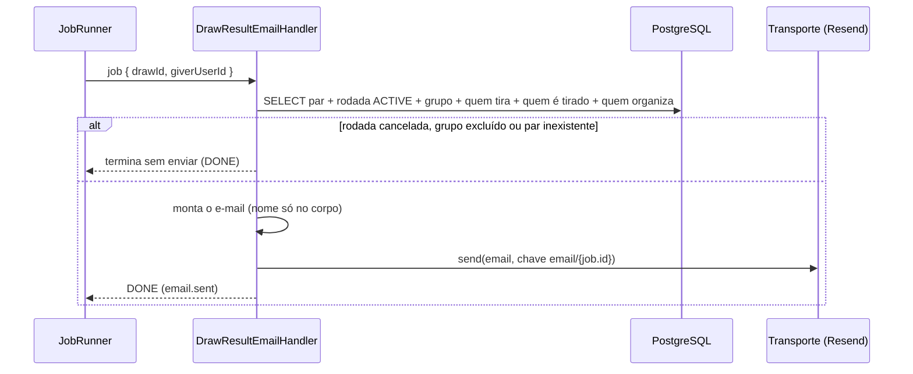

# Draw Design

**Spec**: `.specs/features/06-draw/spec.md`
**Status**: Approved
**Approved**: 2026-11-25 - user: "Aprovada." (inclui os padrões propostos no design, o ajuste do nome no e-mail do resultado na spec e a AD-018)
**Project decisions**: AD-018 (e-mail com conteúdo sigiloso usa job próprio que lê o dado na hora do envio).

---

## Architecture Overview

A API ganha o módulo `draws`, com um controller sob `/groups/:id/...` para o painel, sortear, cancelar, o resultado e os pares de restrição. O serviço usa o `GroupAccess` (AD-016) para 404, 403 e a trava da linha do grupo, conta os sorteios das últimas 24 horas na própria tabela de rodadas e grava rodada, pares sorteados, status do grupo e jobs de e-mail numa transação só. O algoritmo é uma função pura (`draw-algorithm.ts`), testada sozinha, que recebe a fonte de sorte por parâmetro e usa o `randomInt` do `node:crypto` por padrão.

O e-mail do resultado não passa pelo `email.send`: o sorteio enfileira um job `draw.result_email` por participante, só com `{ drawId, giverUserId }`. Na hora de enviar, o handler lê o par da rodada ativa e monta o e-mail; se a rodada foi cancelada ou o grupo excluído, o par não existe mais e o job termina sem enviar. O lembrete é um job `draw.reminder` com `runAt` na hora do sorteio previsto, regravado pelo `GroupsService` quando a data muda.

O site ganha a aba `/grupos/[id]/sorteio` no layout de abas da `05-invites`. A página é montada no servidor e escolhe a visão pelo papel e pelo status; painel, editor e papelzinho são componentes de cliente que chamam a API pelo `apiFetch` e fazem `router.refresh()` depois de cada mudança.

```mermaid
flowchart LR
    subgraph Navegador
      DP[DrawPanel<br/>Sortear, Cancelar]
      EE[ExclusionEditor<br/>Adicionar, Remover par]
      RC[ResultCard<br/>Abrir papelzinho]
    end
    subgraph Next["apps/web (Next)"]
      PX[proxy.ts<br/>/api/* -> API]
      SC[Server Component<br/>/grupos/id/sorteio]
    end
    subgraph Shared["packages/shared"]
      V[validateExclusionInput<br/>tipos e mensagens]
    end
    subgraph API["apps/api (Nest)"]
      DC[DrawsController<br/>/groups/:id/draw, /exclusions]
      DS[DrawsService]
      XS[ExclusionsService]
      AL[draw-algorithm<br/>função pura]
      GA[GroupAccess]
      GS[GroupsService<br/>create, update]
      MS[MembersService<br/>remove, leave]
      RH[DrawResultEmailHandler]
      RM[DrawReminderHandler]
      ES[EmailSender / EmailService]
      BE[BusinessEventsService]
      JR[JobRunner<br/>@Cron]
    end
    DB[(PostgreSQL<br/>exclusion, draw, assignment,<br/>group, membership, job)]

    DP & EE & RC -->|fetch /api + X-CSRF-Token| PX --> DC
    SC -->|GET painel e pares + Cookie| DC
    EE -.usa.-> V
    DC --> DS & XS
    DS --> AL
    DS & XS --> GA
    XS -.usa.-> V
    DS -->|na mesma transação| DB
    GS -->|regrava draw.reminder| DB
    MS -->|apaga pares da pessoa| DB
    JR --> RH & RM
    RH -->|lê o par na hora| DB
    RH --> ES
    RM --> ES
    DS & RM -->|depois do commit| BE
```

Sortear:

```mermaid
sequenceDiagram
    participant B as Navegador
    participant A as API (DrawsService)
    participant D as PostgreSQL
    B->>A: POST /groups/:id/draw
    A->>D: BEGIN; GroupAccess.requireOrganizer (FOR UPDATE no grupo)
    alt fora do grupo / não organiza
        A-->>B: 404 / 403
    else grupo SORTEADO ou ENCERRADO
        A-->>B: 409 com a mensagem do status
    else
        A->>D: SELECT aprovados, contagem de pendentes, pares
        alt menos de 3 / pendentes / sem distribuição
            A-->>B: 409 com a mensagem (e os pares a revisar)
        else
            A->>D: SELECT count(draw) do grupo nas últimas 24 h
            alt 5 ou mais
                A-->>B: 429 "Muitas tentativas..." + Retry-After
            else
                A->>A: drawAssignments(aprovados, pares)
                A->>D: INSERT draw (ACTIVE), INSERT assignment (lote)
                A->>D: UPDATE group SET status = 'DRAWN'
                A->>D: INSERT job draw.result_email (lote, só ids)
                A->>D: COMMIT
                A->>A: draw.performed
                A-->>B: 201 { drawnAt }
            end
        end
    end
```

O e-mail do resultado:



Dois sorteios simultâneos disputam a trava do grupo: o segundo espera, encontra o grupo SORTEADO e recebe 409, sem segunda rodada nem e-mails. Uma entrada, aprovação, saída, remoção ou novo par disputa a mesma trava: ou entra antes, e o sorteio a considera, ou depois, e recebe o 409 do status. O índice único parcial de uma rodada ativa por grupo segura o que escapar.

**Onde as regras rodam.** Condições do painel (contagem de aprovados e pendentes, viabilidade, pares a revisar), sorteio, limite de 5 em 24 horas, quem vê o quê, o nome do resultado e o que os e-mails dizem: API (função pura com testes de unidade; serviço e handlers com testes de integração). Regras do formulário do par e as mensagens: `packages/shared` (`validateExclusionInput`, testes de unidade), usada pelo editor e pela API (AD-015). Textos das condições (singular e plural), visão por papel e status, papelzinho dobrado e aberto: componentes e funções puras do site (testes de componente e de unidade). O navegador não conta, filtra nem ordena nada: participantes do campo de seleção chegam da API em ordem de nome.

---

## Code Reuse Analysis

### Existing Components to Leverage

| Component | Location | How to Use |
| --- | --- | --- |
| `GroupAccess`, `GROUP_NOT_FOUND`, `ORGANIZER_ONLY` | `apps/api/src/groups/group-access.service.ts` | `requireOrganizer` com `lock` em sortear, cancelar e pares; `requireMember` no resultado |
| `CLOSED_GROUP_TRANSFER` ("Grupo encerrado não pode ser alterado.") | `apps/api/src/invites/members.service.ts:37` | 409 de grupo ENCERRADO em sortear, cancelar e pares; passa para um arquivo de mensagens comum |
| `MEMBER_NOT_FOUND` | `apps/api/src/invites/members.service.ts:35` | 404 do par com pessoa que não é aprovada |
| `TooManyAttemptsException` | `apps/api/src/rate-limit/too-many-attempts.exception.ts` | 429 "Muitas tentativas. Tente de novo em N minutos." com `Retry-After`, calculado da rodada mais antiga das 24 horas |
| `GroupValidationException` (400 com `fields`) | `apps/api/src/groups/group-validation.exception.ts` | Erros do par (AD-015) |
| `JobQueue.enqueue` / `enqueueMany`, `JobHandlerRegistry`, `PermanentJobError` | `apps/api/src/jobs/` | Jobs `draw.result_email` e `draw.reminder`; handlers registrados no `onModuleInit` do `DrawsModule`, como o `EmailModule` |
| `SendEmailHandler` (render + transporte + `email.sent`) | `apps/api/src/email/send-email.handler.ts` | O miolo vira `EmailSender.send(message, key)`, exportado pelo `EmailModule`; o `SendEmailHandler` e o handler do resultado chamam o mesmo |
| `EmailService.enqueue`, `email-blocks.ts`, escape do layout | `apps/api/src/email/` | Cancelamento e lembrete pelo `email.send`; os três e-mails com `paragraph` e `button`, e o layout escapa o texto (DRAW-07 AC 7) |
| `BusinessEventsService` | `apps/api/src/observability/business-events.service.ts` | `draw.performed`, `draw.cancelled` depois do commit; `draw.reminder_sent` no handler |
| `group-helpers.ts` (`insertUser`, `insertGroup`, `insertMembership`, `captureEvents`) | `apps/api/test/group-helpers.ts` | Testes de integração; ganha `insertExclusion` e `insertDraw` |
| `GroupTabs` | `apps/web/src/components/group-tabs.tsx` | Ganha a aba "Sorteio" |
| Layout `(tabs)`, `getCurrentGroup`, `GroupHeader` | `apps/web/src/app/grupos/[id]/(tabs)/` | A aba nova entra no mesmo layout |
| `apiServerFetch`, `apiFetch`, `requireUser` | `apps/web/src/lib/` | Leitura do painel e dos pares no servidor; mutações e o resultado com CSRF |
| `ConfirmDialog`, `Alert`, `Button` (`festive`, `night`, `night-ghost`), `Label`, `FieldError` | `apps/web/src/components/` | Confirmações, alertas, botões do painel e do papelzinho, campos do editor |
| Tokens `reveal-*` e `festive` | `apps/web/src/app/globals.css:42-64` | Fundo noturno, papel e selo do papelzinho |
| `formatBrasiliaDate` (horário de Brasília) | `packages/shared/src/brasilia-time.ts:68` | "Sorteio feito em {dd/mm/aaaa}" e a data da confraternização no papelzinho |

### Integration Points

| System | Integration Method |
| --- | --- |
| `GroupsService.create` / `update` | Na transação: apaga o `draw.reminder` pendente do grupo e grava outro quando há sorteio previsto (DRAW-08 AC 1, AC 6) |
| `MembersService.remove` / `leave` | Na transação: apaga os pares em que a pessoa está (DRAW-02 AC 17) |
| `GroupsService.remove` | Sem mudança de código: as chaves estrangeiras com `ON DELETE CASCADE` levam pares, rodadas e pares sorteados; os jobs pendentes conferem o grupo na hora |
| `EmailModule` | Exporta o `EmailSender` novo |
| Banco | Tabelas `exclusion`, `draw`, `assignment`; migration que agenda o lembrete dos grupos ABERTOS com sorteio previsto no futuro (DRAW-08 AC 7) |
| Site | `app/grupos/[id]/(tabs)/sorteio/page.tsx`; `GroupTabs` com a terceira aba |

---

## Components

### Shared: tipos e regras do sorteio (`packages/shared/src/draws.ts`)

- **Purpose**: Tipos das respostas, mensagens e a regra do formulário do par, iguais no site e na API.
- **Interfaces**:
  - `validateExclusionInput(input: { a: string | null; b: string | null }, pairs: ExclusionPair[]): { a?: string }` - "Escolha as duas pessoas do par.", "Escolha duas pessoas diferentes.", "Esse par já está na lista." (em qualquer ordem); o erro fica no campo "Pessoa"
  - `DRAW_MESSAGES` - textos dos 409 do sorteio, do cancelamento e dos pares
  - Tipos `DrawPanel`, `ExclusionsResponse`, `ExclusionPair`, `DrawResult`
- **Reuses**: o molde de `validateGroupInput` (AD-015)

### API: algoritmo (`apps/api/src/draws/draw-algorithm.ts`)

- **Purpose**: Distribuir os participantes, conferir a viabilidade e achar os pares a revisar.
- **Interfaces**:
  - `drawAssignments(people: string[], exclusions: [string, string][], random?: (max: number) => number): { kind: 'ok'; pairs: Map<string, string>; singleCycle: boolean } | { kind: 'blocked'; blocked: string[] }`
  - `findBlocked(people, exclusions): string[] | null` - `null` quando há distribuição; usado pelo painel
- **Como funciona**:
  1. Sem pares: embaralha com Fisher-Yates e `randomInt`, e cada pessoa tira a seguinte, a última tira a primeira. Linear (DRAW-04 AC 7, AC 24).
  2. Com pares: emparelhamento máximo bipartido (Hopcroft-Karp) sobre "pode tirar" (diferente de si e fora dos pares). Se não cobre todos, uma busca alternada a partir de quem ficou sem par acha o conjunto S de quem, junto, tem menos pessoas permitidas do que o tamanho de S (teorema de Hall); devolve `blocked = S` (DRAW-03 AC 8, DRAW-04 AC 18).
  3. Com pares e distribuição possível: busca em profundidade de uma corrente única, com início e vizinhos embaralhados e um orçamento de 2.000.000 de passos. Até 10 pessoas, a busca completa cabe no orçamento (DRAW-04 AC 8).
  4. Sem corrente no orçamento: emparelhamento com a ordem das pessoas e dos vizinhos embaralhada; `singleCycle` sai do resultado (DRAW-04 AC 9).
- **Reuses**: `randomInt` do `node:crypto`, como o código do convite

### API: `DrawsModule`

- **Location**: `apps/api/src/draws/`
- **Rotas** (todas autenticadas, mutações com CSRF):

| Rota | Quem | Resposta |
| --- | --- | --- |
| `GET /groups/:id/draw` | quem organiza | `{ status, drawnAt, approved, pending, feasible, pairsToReview }` |
| `POST /groups/:id/draw` | quem organiza | 201 `{ drawnAt }` |
| `DELETE /groups/:id/draw` | quem organiza | 204 |
| `GET /groups/:id/draw/result` | participante aprovado | `{ receiverName }`, `Cache-Control: no-store` |
| `GET /groups/:id/exclusions` | quem organiza | `{ participants: [{ membershipId, name }], pairs: [{ id, a, b }] }`, em ordem de nome |
| `POST /groups/:id/exclusions` | quem organiza | 201 `{ id, a, b }`; corpo `{ a: membershipId, b: membershipId }` |
| `DELETE /groups/:id/exclusions/:pairId` | quem organiza | 204, também quando o par não existe |

- **DrawsService**: `panel`, `perform`, `cancel`, `result`. Ordem das recusas do sorteio: 404, 403, 409 de status, 409 do mínimo, 409 dos pendentes, 409 das restrições, 429 (AD-016 e DRAW-04 AC 19).
- **ExclusionsService**: `list`, `add`, `remove`. Pessoas entram e saem pela `membershipId`, como na lista de participantes; nenhuma resposta leva id de pessoa.
- **DrawResultEmailHandler** (`draw.result_email`): lê o par da rodada ativa; sem par, termina sem enviar; com par, monta o e-mail e chama `EmailSender.send` com a chave `email/{job.id}`.
- **DrawReminderHandler** (`draw.reminder`): lê o grupo; se não existe, não está ABERTO ou o sorteio previsto não é o do payload, termina; senão enfileira o `email.send` a quem organiza agora e emite `draw.reminder_sent`.
- **`scheduleDrawReminder(manager, groupId, at)`** (`draw-reminder.ts`): apaga o `draw.reminder` PENDING do grupo e, com `at`, grava outro com `runAt = at` e payload `{ groupId, drawScheduledAt }`. Chamado pelo `GroupsService`; função com o `manager`, sem injeção, para o `GroupsModule` não depender do `DrawsModule`.
- **Dependencies**: `GroupsModule` (`GroupAccess`), `EmailModule` (`EmailService`, `EmailSender`), `JobsModule` (`JobQueue`, `JobHandlerRegistry`), `BusinessEventsService`.

### API: mudanças em features anteriores

- `GroupsService.create` e `update`: chamam `scheduleDrawReminder` na transação quando o sorteio previsto é gravado, mudado ou tirado.
- `MembersService.remove` e `leave`: apagam da `exclusion` as linhas do grupo com a pessoa em `userAId` ou `userBId`.
- `SendEmailHandler`: passa a delegar ao `EmailSender`, sem mudar o comportamento.

### Web: dados do servidor (`apps/web/src/lib/draws.ts`)

- `getDrawPanel(groupId)` e `getExclusions(groupId)` com `apiServerFetch`; 404 vira `null`, outros status lançam, como `getGroup`.

### Web: telas

- `app/grupos/[id]/(tabs)/sorteio/page.tsx` (servidor): lê o grupo pelo `getCurrentGroup`; quem organiza também lê o painel e os pares. Escolhe a visão:

| Papel | ABERTO | SORTEADO | ENCERRADO |
| --- | --- | --- | --- |
| Quem organiza | `DrawPanel` + `ExclusionEditor` | `ResultCard` + `DrawPanel` (feito, com "Cancelar sorteio") + pares só leitura com a nota | `ResultCard` + "Sorteio feito em" + pares só leitura |
| Participante | Aviso de que o sorteio não foi feito | `ResultCard` | `ResultCard` |

- `components/draw-panel.tsx` (cliente): condições, "Sortear" `festive`, frase de sigilo; confirmações de sortear e cancelar; "Sorteando…" e "Cancelando…"; alerta de erro; `router.refresh()` no sucesso.
- `components/exclusion-editor.tsx` (cliente): campos de seleção nativos, "Adicionar par", lista com "Remover par {A} e {B}", alerta dos pares a revisar; valida com `validateExclusionInput` antes de enviar; erros com `aria-describedby`; `router.refresh()` depois de cada mudança, para o painel recalcular a viabilidade.
- `components/result-card.tsx` (cliente): começa dobrado, sem o nome; "Abrir papelzinho" busca `/api/groups/{id}/draw/result`, abre e anuncia numa região `role="status"`; "Esconder" dobra e apaga o nome do estado; 404 faz `router.refresh()`. Animação em CSS (`globals.css`), só com `motion-safe:`; estrelas em posições fixas, para o HTML do servidor e o do navegador baterem.
- `lib/draw-format.ts`: textos das condições ("Falta 1 pessoa" / "Faltam N pessoas", "1 pessoa aguarda" / "N pessoas aguardam"), "Sorteio feito em {dd/mm/aaaa}" e a linha do grupo no papelzinho.

---

## Data Models

### Exclusion (`exclusion`)

```typescript
interface Exclusion {
  id: string;          // uuid
  groupId: string;     // -> group, ON DELETE CASCADE
  userAId: string;     // -> user; sempre o menor dos dois ids
  userBId: string;     // -> user
  createdAt: Date;
}
// CHECK ("userAId" < "userBId"); UNIQUE ("groupId", "userAId", "userBId")
```

### Draw (`draw`)

```typescript
interface Draw {
  id: string;
  groupId: string;                    // -> group, ON DELETE CASCADE
  status: 'ACTIVE' | 'CANCELLED';
  singleCycle: boolean;               // para o evento draw.performed
  createdAt: Date;                    // "Sorteio feito em"; limite de 24 h
  cancelledAt: Date | null;
}
// CHECK (("status" = 'CANCELLED') = ("cancelledAt" IS NOT NULL))
// UNIQUE ("groupId") WHERE "status" = 'ACTIVE'; INDEX ("groupId", "createdAt")
```

### Assignment (`assignment`)

```typescript
interface Assignment {
  id: string;
  drawId: string;          // -> draw, ON DELETE CASCADE
  giverUserId: string;     // -> user
  receiverUserId: string;  // -> user
}
// UNIQUE ("drawId", "giverUserId"); UNIQUE ("drawId", "receiverUserId")
// CHECK ("giverUserId" <> "receiverUserId")
```

**Relationships**: um grupo tem muitos pares de restrição e muitas rodadas, no máximo uma ativa; a rodada ativa tem um par sorteado por participante. Cancelar apaga os pares sorteados e mantém a rodada como CANCELLED. Nomes `Draw` e `Assignment` como no `scope.md` 6, que a `09-secret-messages` liga às conversas.

### Jobs

| Tipo | Payload | runAt |
| --- | --- | --- |
| `draw.result_email` | `{ drawId, giverUserId }` | agora |
| `draw.reminder` | `{ groupId, drawScheduledAt }` | sorteio previsto |

---

## Error Handling Strategy

| Error Scenario | Handling | User Impact |
| --- | --- | --- |
| Fora do grupo, id que não é UUID | 404 "Grupo não encontrado." (`GroupAccess`) | "Grupo não encontrado." sem as abas |
| Ação de quem organiza por participante | 403 "Só quem organiza pode alterar o grupo." | Não acontece pela tela (sem controles) |
| Sortear com grupo SORTEADO / ENCERRADO | 409 com a mensagem do status | Alerta vermelho no painel |
| Menos de 3 aprovados / pendentes / sem distribuição | 409 com a mensagem; sem distribuição, `pairsToReview` no corpo | Alerta no painel; o botão já estava desabilitado, então só acontece se o grupo mudou depois de a aba abrir |
| 5 sorteios em 24 horas | `TooManyAttemptsException` 429 + `Retry-After` | "Muitas tentativas. Tente de novo em N minutos." |
| Cancelar com grupo ABERTO / ENCERRADO | 409 com a mensagem | Alerta no painel |
| Par inválido | 400 com `fields.a` (AD-015) | Mensagem abaixo do campo (o site barra antes) |
| Par com pessoa que não é aprovada | 404 "Participante não encontrado." | Alerta no editor e a aba recarrega |
| Par com grupo SORTEADO / ENCERRADO | 409 com a mensagem | Alerta no editor |
| Resultado sem rodada ativa | 404 "Sorteio não encontrado." | A aba recarrega |
| Falha ao abrir o papelzinho (5xx, rede) | `apiFetch` devolve a falha | "Não foi possível abrir o papelzinho. Tente de novo." e o papel fica dobrado |
| Falha no meio do sorteio ou do cancelamento | Transação desfeita: rodada, pares, status, jobs e evento ficam como antes | "Não foi possível concluir. Tente de novo." |
| Job de resultado sem par (cancelado, excluído) | Termina como DONE, sem envio nem erro | Ninguém recebe o nome de uma rodada inválida |
| Falha do transporte no job de resultado | Erro passageiro: retry da fila com a mesma chave de idempotência | E-mail chega na próxima tentativa, uma vez só |

---

## Risks & Concerns

| Concern | Location (file:line) | Impact | Mitigation |
| --- | --- | --- | --- |
| Gravar o `draw.reminder` dentro de `create` e `update` muda o que esses métodos gravam na tabela `job` | `apps/api/src/groups/groups.service.ts:192`, `:279` | Testes da `04-groups` que contam ou leem todos os jobs | A task do lembrete roda as suítes de grupos e ajusta só asserções que leem a tabela inteira; nenhuma asserção de comportamento muda |
| Remover e sair passam a apagar pares | `apps/api/src/invites/members.service.ts:287`, `:331` | Muda o efeito de duas rotas da `05-invites` | Testes de integração novos nas duas rotas; os existentes não têm pares |
| Extrair o `EmailSender` do `SendEmailHandler` | `apps/api/src/email/send-email.handler.ts:18` | Regressão no envio de todos os e-mails | Os testes do handler continuam valendo sem mudança; o `EmailSender` ganha os dele |
| `assignment` aponta para `user` sem cascata | migration nova | A exclusão de conta (`11-account-deletion`) não apaga a pessoa com par ativo | Fica `RESTRICT` de propósito; a `11` decide o que fazer com a rodada (RN12) |
| Apagar o lembrete pendente filtra `job.payload` (jsonb) sem índice | `draw-reminder.ts` | Lento com a tabela `job` muito grande | O filtro usa também `type` e `status = 'PENDING'`; jobs feitos são limpos pela `10-lifecycle`; anotado para medir |
| Viabilidade a cada leitura do painel | `DrawsService.panel` | Grupos enormes com pares pagam um emparelhamento por leitura | Sem pares, nada é calculado; com pares, Hopcroft-Karp em grupos de mil cabe em dezenas de milissegundos; anotado para medir |
| O nome sorteado passa pelo transporte e pode ir parar num erro | `DrawResultEmailHandler` | Vazamento em log ou Sentry (DRAW-09 AC 4) | O handler não loga o e-mail; as mensagens de erro dos transportes já não levam destinatário nem corpo (`02-email-jobs`); teste captura log e Sentry de um envio que falha |
| Estrelas em posições aleatórias | `result-card.tsx` | HTML do servidor diferente do navegador (erro de hidratação) | Posições fixas numa lista |
| Teste de mil participantes no banco dos testes | teste de integração do sorteio | Suíte lenta | Usuários e participações inseridos por `INSERT` em lote; mede só a chamada do sorteio |

---

## Tech Decisions (only non-obvious ones)

| Decision | Choice | Rationale |
| --- | --- | --- |
| E-mail do resultado | Job próprio `draw.result_email` com `{ drawId, giverUserId }`, que lê o par e monta o e-mail na hora de enviar | O nome não fica na fila e o e-mail não sai se a rodada foi cancelada - user: "Job próprio que monta na hora (Recomendado)", entre essa e "Nome cifrado no payload" |
| Lembrete | Job `draw.reminder` com `runAt` no sorteio previsto; mudar a data apaga o pendente e grava outro; o job confere status e data na hora | Usa a fila que já existe - user: "Job com runAt (Recomendado)", entre essa e "Varredura periódica" |
| Limite de 5 sorteios | Conta as rodadas do grupo nas últimas 24 horas, dentro da transação que trava o grupo | Janela móvel exata - user: "Contar na tabela de rodadas (Recomendado)", entre essa e "Tabela rate_limit" |
| Par de restrição | Uma linha por par, com `userAId < userBId` e único por grupo | Os dois sentidos batem no mesmo índice - user: "Uma linha por par (Recomendado)", entre essa e "Duas linhas direcionais" |
| Módulo da API | Módulo novo `draws`, que importa `GroupsModule`, `EmailModule` e `JobsModule` | `groups` e `invites` mudam pouco - padrão do agente, aprovado com o design, user: "Aprovada." |
| Algoritmo | Fisher-Yates sem pares; com pares, Hopcroft-Karp para viabilidade e pares a revisar, busca de corrente com orçamento de 2.000.000 de passos, e emparelhamento embaralhado sem corrente | Linear sem pares; exato na viabilidade; corrente garantida até 10 pessoas - padrão do agente, aprovado com o design, user: "Aprovada." |
| Fonte de sorte | `randomInt` do `node:crypto`, recebido por parâmetro com esse padrão | Testes passam uma fonte fixa; o teste da fonte espiona o `node:crypto`, como o código do convite - padrão do agente, aprovado com o design, user: "Aprovada." |
| Rotas | As da tabela do `DrawsModule`; cancelar é `DELETE /groups/:id/draw` | A rodada ativa é um recurso do grupo - padrão do agente, aprovado com o design, user: "Aprovada." |
| Resultado | `GET /groups/:id/draw/result` chamado só pelo navegador no toque, com `Cache-Control: no-store` | O nome nunca está no HTML da página (DRAW-05 AC 2) - padrão do agente, aprovado com o design, user: "Aprovada." |
| Painel | Só quem organiza lê `GET /groups/:id/draw`; o participante não precisa dele | Contagens e pares a revisar são de quem organiza - padrão do agente, aprovado com o design, user: "Aprovada." |
| Pessoas nos pares | Entram e saem por `membershipId`; a tabela guarda ids de pessoa | Nenhuma resposta leva id de pessoa, como a lista da `05-invites` - padrão do agente, aprovado com o design, user: "Aprovada." |
| Rodada cancelada | `status = CANCELLED`, `cancelledAt`, pares sorteados apagados | Assumption aprovada na spec - padrão do agente, aprovado com o design, user: "Aprovada." |
| Nome no e-mail do resultado | O nome lido na hora do envio (segundos depois do sorteio, ou na tentativa seguinte) | Consequência do job que monta na hora; a spec dizia "nome da hora do sorteio" e passa a dizer "nome da hora do envio" - padrão do agente, aprovado com o design, user: "Aprovada." |
| `EmailSender` | O render, o envio com chave e o `email.sent` saem do `SendEmailHandler` para um serviço exportado pelo `EmailModule` | Os dois handlers mandam e-mail do mesmo jeito - padrão do agente, aprovado com o design, user: "Aprovada." |
| Lembrete agendado de fora do módulo | `scheduleDrawReminder(manager, ...)` sem injeção, chamado pelo `GroupsService` | Evita dependência circular entre `groups` e `draws` - padrão do agente, aprovado com o design, user: "Aprovada." |
| Pares de quem sai | `MembersService` apaga pela entidade `Exclusion` no mesmo `manager` | Mesma transação da saída, sem importar o módulo - padrão do agente, aprovado com o design, user: "Aprovada." |
| Atualizar a aba | `router.refresh()` depois de sortear, cancelar, adicionar e remover par | Painel e editor vêm do servidor; a viabilidade é recalculada pela API - padrão do agente, aprovado com o design, user: "Aprovada." |
| Animação do papelzinho | CSS em `globals.css`, só dentro de `motion-safe:`; sem dependência nova | Movimento reduzido sem animação (DRAW-05 AC 11) - padrão do agente, aprovado com o design, user: "Aprovada." |
| Campos do par | `<select>` nativo com os aprovados em ordem de nome | Assumption aprovada na spec; acessível no celular - padrão do agente, aprovado com o design, user: "Aprovada." |
| Evento `draw.reminder_sent` | Emitido pelo handler do lembrete quando enfileira o e-mail | É o que o lembrete controla; o envio em si é do `email.send` - padrão do agente, aprovado com o design, user: "Aprovada." |
| Padrão para e-mails sigilosos | Proposto como AD-018: e-mail com conteúdo sigiloso (resultado do sorteio, e na `09` as mensagens secretas) usa job próprio que lê o dado na hora do envio, nunca o texto pronto no payload | A `09-secret-messages` tem o mesmo problema - padrão do agente, aprovado com o design como AD-018, user: "Aprovada." |
